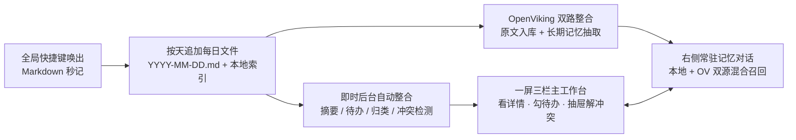

# Flash Marking Down 产品与开发规格 v1.0

更新于 2026-11-24。本版基于 2026-11-24 的产品决策，描述 v1.0 的设计目标和实现边界。当前开发版能力见 [README](README.md)。

## 1. 产品定位与唯一主闭环

Flash Marking Down 是面向个人的 Windows 轻量 Markdown 快记与对话式记忆工作台。核心目标是**降低随时记录的门槛，并在几天后通过对话自然找回原话、待办和观点脉络**。

**核心设计原则**：
- **先用起来**：只做跑通日常高频闭环必需的能力，不提前建设企业级分布式事务、复杂审计账本或未验证的扩展模块。
- **本地 Markdown 权威**：用户笔记与待办永远是可读、可迁移、可用 Obsidian 等外部编辑器直接打开的普通 Markdown 文件。
- **后台静默干活，前台零打断**：保存即完成，模型整合与 OpenViking 同步全部在后台异步进行；离线、模型失败或 OV 不可用绝不阻塞记录与本地检索。
- **主打务实保护**：保存草稿，将写入限制在工作区，保护外部编辑和凭据。兼容云盘同步、目录重命名和备份拷贝。

## 2. 范围边界与重构阶段

一次打开一个本地 Markdown 工作区；大模型与 OpenViking 各自独立配置、独立启停。

| 阶段 | 代号 | 核心交付与用户可用能力 |
|---|---|---|
| 阶段一 | **R1 务实底座减负** | 松绑目录常驻锁/重解析点/NTFS 绑定；合并配置为 `settings.json`；改为每日 Markdown 文件块追加；快捷窗失败可逃生；切 `reqwest` 并上线模型/OV 合并配置与一键测试连接；任务复选框直接轻快改写。 |
| 阶段二 | **R2 一屏工作台与后台整合** | 重构主窗为三栏一屏 + 辅助抽屉；上线保存后即时后台自动整理 Worker（摘要/决定/待办/冲突检测/Wiki 建议）；落地 Git Merge Conflict 风格冲突解决抽屉与清爽 Wiki 变更抽屉；多轮对话持久化、本地图片渲染、取消 `Ctrl+C` 劫持。 |
| 阶段三 | **R3 OpenViking 深度整合** | 落地 `MemoryProvider` 接口抽象与 `OpenVikingProvider`；打通每日原文同步 `resources` + 笔记要点提交 Session 抽取 `memories`；右侧对话升级为本地 + OV 双源混合召回、流式输出与离线降级补推。 |

**本期明确暂缓**：
- 文章 URL 抓取与主动回忆学习流程（原 WP-06）：待核心快记与记忆对话闭环经 1–2 周真实日常使用验证后，再按实际体感决定形态。
- 第二种真实记忆服务实机接入（原 WP-08）：代码层面保留 `MemoryProvider` trait 解耦，本期全力打透 OpenViking，不为假设的第二服务编写双服务验收。
- 语音输入、移动端、多设备同步引擎、团队权限平台、复杂知识图谱。macOS 属后续跨平台扩展。

## 3. 工程结构与数据责任

技术栈沿用 Tauri 2 + Vue 3 + Rust + 内置 SQLite（[ADR-01](docs/spec/adr-01-options.md)），外部 HTTP 复用 `reqwest` 统一承载大模型与 OpenViking 通信（[ADR-02](docs/spec/adr-02-model-and-memory.md)）。

| 数据类别 | 权威位置 | 维护与容错策略 |
|---|---|---|
| 每日随手记、已有笔记、Wiki、任务清单 | 工作区内的 `.md` 文件 | 用户随时可用外部工具编辑；应用改写已有文件前核对内容是否变动以防覆盖 |
| 笔记元数据、整理结果、冲突、对话历史、同步状态 | `<workspace>/.flash-marking-down/state.sqlite`（Schema v5） | 备份工作区时随目录拷贝即可迁移，不绑定 NTFS 磁盘索引号 |
| 本地搜索索引 | `state.sqlite` 派生表（`search_documents` + FTS5 trigram） | 按 `(mtime, size)` 增量更新，可随时从工作区 Markdown 重建，不删业务状态 |
| 应用全局设置（上次工作区、热键、偏好） | `%LOCALAPPDATA%/.../settings.json` | 单文件原子写回，替代多个单值 SQLite 库 |
| 模型与 OpenViking API Key | Windows 系统凭据管理器 | 工作区与日志绝不落盘明文密钥 |
| 远端资源与长期记忆 | OpenViking 服务（经 `MemoryProvider` 接口访问） | 远端离线或失败时记录本地待补推状态，不阻塞本地闭环 |

## 4. 功能需求（FR-01 至 FR-07）

详细数据结构、协议与命令签名见 [数据与接口约定 v1.0](docs/spec/data-contracts.md)，验证标准见 [验收规格 v1.0](docs/spec/acceptance.md)。

### FR-01 工作区、务实文件访问与统一配置
- 首次启动选择工作区根目录与随手记保存子目录（留空则存根目录）即可开始记录与离线检索；允许随时更新默认保存子目录。
- **务实文件系统行为**：不长期持有父目录链的防删句柄；兼容 OneDrive/iCloud 按需文件、Obsidian Junction/符号链接、硬链接及备份拷贝迁移。保留基本安全边界：仅读写工作区根目录内的普通 Markdown 文件，自动排除 `.flash-marking-down` 状态目录。
- 全局快捷键（默认 `Win+Alt+N`，冲突时可切换）与上次工作区记录保存在单个 `settings.json` 中；托盘提供「新建笔记 / 打开工作台 / 退出」。
- 打开旧应用配置时，首次生成 `settings.json` 会导入上次工作区和热键。它也保存自动整理、自动同步的偏好，后台执行分别在 R2 和 R3 接入。
- **模型与 OpenViking 统一设置**：在设置弹窗内各自支持一屏填写地址、模型/命名空间、API Key（可选直写 Windows 凭据管理器，修复 UTF-16 长度上限）并**一次保存**，均提供**一键「测试连接」**按钮验证可达性与认证身份。

### FR-02 全局快捷窗与按天每日文件落盘
- 通过全局快捷键、托盘或主窗按钮唤出独立快捷笔记窗（隐藏窗口复用，保持热唤出响应流畅）。
- 单栏 Markdown 原位实时预览，支持中文 IME 组词保护（组词期不误触发保存或关窗）；`Enter` 换行，`Ctrl+Enter` 保存并交还前台焦点。
- **按天落盘每日文件**：新记录按本机日期追加写入 `<capture_dir>/<YYYY-MM-DD>.md`（不存在则创建并以 `# YYYY-MM-DD` 开头），每条使用人类可读的时间戳小节与轻量块锚点 `## HH:MM:SS <!-- fmd-note:<id> -->`；**完全兼容读取、搜索和展示工作区中已有的历史一记一文件及普通 Markdown**。
- 最近记录按随手记块查看和整理，搜索按 Markdown 文件返回匹配结果。每日文件的链接仍可交给外部编辑器打开。
- **务实草稿与保存容错**：输入防抖自动落盘草稿；写文件采用常规「同目录临时文件 → flush → 原子重命名」，前端凭 `requestId` 防双击重复。保存或草稿落盘失败时**不锁死编辑器为只读、不死锁关窗或托盘退出**，明确提供「重试 / 复制正文 / 忽略草稿强制关闭」。

### FR-03 保存后即时后台自动整合与轻量待办
- 保存成功后立即返回，后台单 Worker 自动执行整合流水线（设置中提供「保存后自动整理」「保存后自动同步 OpenViking」独立开关，启用对应服务时默认开启）：
  1. 若启用 OpenViking：同步当日笔记到 OV 资源空间；
  2. 若启用大模型：基于新笔记内容结合本地 FTS5 与 OV 召回的 Top 相关历史片段，一次调用生成结构化整理结果——**简短摘要、明确决定、行动待办（缺失负责人与日期保持空缺，不幻觉补齐）、观点冲突检测、以及可选 Wiki 更新建议**；
  3. 若启用 OpenViking 记忆抽取：将本次整理后的笔记要点提交 OV Session 沉淀为长期记忆。
- 后台失败或模型未启用时，仅在该记录上展示安静状态与「重试 / 手动整理」入口，不弹窗打断工作。
- **轻量 Markdown 待办**：待办统一以映射的 Markdown 任务清单（或原笔记复选框）为唯一状态权威。在主屏左栏「待办」或中栏内联整理区点击复选框（含用户手写的普通 `- [ ]` 任务），直接定位行轻快改写 `[ ]` ↔ `[x]`；写前做轻量内容校验防覆盖外部编辑，不再走重型审批单也不污染 Wiki 变更列表。待办条目显示负责人、截止日期与可点击跳转的来源。

### FR-04 一体化三栏主工作台
- 沿用 [UI 设计基准 DESIGN-01](docs/spec/ui-design.md) 的深色 Cognitive Slate 视觉体系，取消左侧 7 模块平铺导航，收拢为**三栏一屏 + 顶部极简栏 + 右侧辅助抽屉**：
  - **顶部栏**：全局搜索框（`Ctrl+K`，支持关键词与快捷日期筛选）、`+ 随手记`、右上角轻量入口 `⚡ 冲突/变更 (N)`（有待处理项时高亮）与 `⚙ 设置`。
  - **左栏**：`记录`（按日分组的笔记流与搜索结果，带极简整合/OV/冲突圆点状态）与 `待办 (N)` 双切视图。
  - **中栏**：选中记录的 Markdown 原文（支持预览/源码切换、工作区本地相对路径图片展示、外部打开/定位）+ **同屏内联展示该记录的后台整理摘要、明确决定、可勾选待办、OV 同步状态与冲突快捷入口**。
  - **右栏**：常驻可折叠的**多轮记忆对话面板**，支持新建会话、翻阅历史对话、自由追问。
- 主流程隐藏内部哈希、UUID 和锚点注释字符串（技术详情仅折叠在错误提示的 `
` 中）。

### FR-05 Git 冲突式观点分歧处理与 Wiki 变更抽屉
- **Git Merge Conflict 心智模型**：后台自动检测或用户手动标记观点分歧时，进入右上角 `⚡ 冲突/变更` 抽屉的「冲突」页签，像 Git 合并冲突一样展示双边对比 Diff：
  - `Current`（已有记录/当前有效观点，附来源与日期） vs `Incoming`（新记录主张，附来源与日期）。
  - 提供一键三选一决策：**采纳当前（Keep Current）**、**采纳新记录（Accept Incoming，可联动更新关联 Wiki 并同步 OV）**、**保留双方（Keep Both，可选备注适用条件）**。
- **彻底取消过重审计约束**：单条冲突数据异常仅局部提示，绝不全局熔断问答；不劫持用户正常 `Ctrl+C` 复制；不要求精确唯一子串定位；不做墓碑防泄漏审计。
- **Wiki 变更页签**：仅呈现真正的 Wiki 文档更新建议（支持追加或局部差异预览、采用/拒绝、撤销，以及管理/解除已映射的 Wiki 目标），写前校验文件未被外部修改防覆盖。

### FR-06 对话式双源记忆召回
- 用户在主屏右侧对话面板通过自然语言多轮提问，系统并行从**本地 FTS5 索引**与**已启用的 OpenViking（记忆 + 资源）**召回候选片段，去重整合后流式生成带来源引用的回答。
- 回答采用 Markdown 渲染，文内 `[1]` `[2]` 引用支持一键点击在中栏定位本地原文或预览 OV 记忆内容；若涉及已记录且保留双方的观点分歧，在回答下方以紧凑卡片醒目提示并支持一键打开冲突 Diff。
- 允许用户自由划词复制，并提供「复制（含引用出处）」快捷按钮。OV 不可用或未启用时自动平滑降级为纯本地召回并温和标注；模型未启用时直接引导使用左侧离线全文搜索。

### FR-07 连接器接口解耦与 OpenViking 双路整合
- 后端抽象 `MemoryProvider` trait，隔离业务流程与具体记忆存储产品；本期专注落地并打透 `OpenVikingProvider`（对接本机 OpenViking v0.5.2 HTTP API）。
- **双路整合策略**：
  - **知识原文路**：通过 `POST /api/v1/content/write`（`wait: false`）将每日笔记同步到工作区专属前缀 `viking://resources/flash-marking-down/<workspace>/daily/<YYYY-MM-DD>.md`，利用 OV 自动生成 L0/L1 分层摘要与向量索引。
  - **长期记忆路**：通过 `POST /api/v1/sessions` → `messages` → `/{session_id}/commit`（`wait: false`）将整理后的新笔记要点交由 OV 记忆引擎抽取沉淀为长期 `memories`。
  - **召回读取路**：通过 `POST /api/v1/search/search`（或 `/find`）与 `GET /api/v1/content/overview|read` 参与对话召回与背景关联。
- 同步失败不阻塞本地使用，本地记录 `pending | synced | failed` 轻量状态，支持自动重试或手动一键补推。

## 5. 安全边界与性能基线

- **安全底线**：读写限定在工作区根目录内且排除 `.flash-marking-down`；API Key 仅存 Windows 凭据管理器，不入库、不进日志；Markdown 渲染禁止执行脚本，远程外链图片不自动加载（工作区本地相对路径图片允许加载）；来源正文仅作数据，不赋予模型工具/文件写权限。
- **性能基线**：
  - 快捷窗热唤出（托盘常驻隐藏复用）：p95 ≤ 300 ms，打开即可中文组词输入；
  - 随手记本地保存（写每日文件 + 增量索引）：p95 ≤ 200 ms（不含后台异步模型与 OV）；
  - 本地离线搜索（5,000 篇文档增量索引 + FTS5 混合检索）：p95 ≤ 2 s（含单/双汉字查询）。
