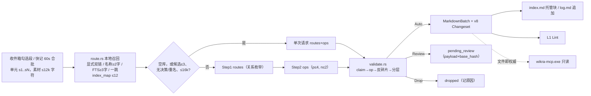

# Wikra P0 三轨方案比对与统一定稿（合成稿）

> 合成人：方案比对与合成（Claude Opus 5.5 High）｜基线：`main` @ `46a06e4`（已核对 `git rev-parse`）
> 本轮只读：没有修改仓库文件，没有写看板，没有调用其他 agent。看板 `2026-11-27-wikra-p0-compiler-lint-mcp` 请主控回写。
> 三方的源码说法有冲突或只有一方提到的地方，我都逐条打开源码核对过，结论标在第二部分。

---

## 第一部分：三方案逐条比对与归因矩阵

### 1. M1 编译步数与自适应合并

| | 立场 |
|---|---|
| Neon | 固定两步，空库时跳过 Step 1 |
| Claude | 两步；候选 ≤3 页且总长在预算内时合并为一步 |
| Astra | 两步契约不变；只有唯一目标、装得下、不涉及核心页，或者空库时，才合并为一次请求；遇到重名、多主题、决策页或可能冲突时必须拆开 |

**采纳**：融合 Claude 和 Astra。路由契约和编辑契约始终分开定义；满足以下任一条件时用一次请求同时返回 `routes + ops`：① 库里没有非 meta 内容页；② 候选 ≤3、候选中没有 `decision/wikra-core` 页、没有重名，且估算输入 ≤16k 字符。不管走一步还是两步，后续校验完全相同。

**未采纳**：Neon 的固定两步会让每条短快记都付两次模型费，P0 主力场景正是短快记。Astra 的“唯一目标”条件太严，而 Claude 的“≤3”已经能覆盖“一条快记补两三个相关页”这种常见情况。决策页和重名的排除条件取自 Astra，用来补上 Claude 条件里缺的风险门槛。

### 2. M1 本地召回与 `index_map` 规模

| | 立场 |
|---|---|
| Neon | 4 路打分，`index_map` 取 60 行；召回不足时用最近更新页和 decisions 补齐；`SCHEMA.md` 截取前 2,400 字 |
| Claude | 名称命中（中文 ≥3 字）+ FTS5 bm25 + 一跳邻域，K≤12；`SCHEMA.md` 截取 4KB |
| Astra | 2 字中文词先查标题、别名、文件名，FTS 只用于 ≥3 字的词；显式双链优先；`index_map` 8 行，Step 2 最多展开 4 页；meta 页不贡献邻域票；`SCHEMA.md` 按标题切片 |

**采纳**：召回信号和排序用 Neon 的 4 路打分（显式双链 +100、标题 +40 / 别名 +30、FTS +10~35、一跳邻居 +15）。阈值采用 Astra 的：名称字典匹配接受 ≥2 个中文字符（ASCII ≥3 字符，且要求单词边界），FTS 只查 ≥3 字符的词（≤8 个），重名直接跳过。`index_map` 上限取 Claude 的 **12 行**。Step 2 最多展开 **4 个已有页 + 2 个新页槽位**，这一点取 Astra。index/log/SCHEMA/SKILL 不参与邻域加权（Astra）。`SCHEMA.md` 不超过 4KB 时整份送入；超过时取全局章节加本批涉及页型的章节，按 H2 切片（融合 Claude 和 Astra）。

**未采纳**：
- Neon 的 60 行和“用最近更新页补齐到 60”：补进来的是噪声，2.1k token 大部分浪费，还会诱导模型去改不相关的页。
- Claude 的“中文名 ≥3 字”：会漏掉“网关”“重试”这类两字概念。源码已证实 `fts_trigram_phrase` 对少于 3 个字符的词直接返回 `None`（`search.rs:75`），两字词只能走名称字典。
- Astra 的“规范含义冲突就转审阅”：Rust 无法判定规范是否冲突，这条规则落不了地。

### 3. M1 模型引用页面方式与新页命名

| | 立场 |
|---|---|
| Neon | 模型直接输出路径；新页文件名用 `slug.md` |
| Claude | 模型只用短引用号 `p1/n1`；新页文件名用 `标题.md`，去掉 Windows 非法字符，重名加 ` (2)` |
| Astra | 短引用 `p1/h1/s1/n1`；文件名由 Rust 按目录映射生成（没写具体格式） |

**采纳**：短引用号（Claude 和 Astra 一致），并吸收 Astra 的 `hN` 章节引用：`replace_section` 的基线哈希由 Rust 按 `hN` 自己记住，不要求模型回显。新页文件名用 Claude 的 **`标题.md`**（列为拍板项 D4）。

**未采纳**：Neon 让模型输出路径，模型容易编造路径或越界，Rust 还得再做一遍路径归一化和校验，等于重复造边界。`slug.md` 的问题在于 Obsidian 以文件名作为链接目标：`[[重试与退避策略]]` 在 slug 文件名下无法原生解析，只能写成 `[[retry-policy|重试与退避策略]]`，用户在 Obsidian 里手写 `[[标题]]` 时会产生断链，往返保真就打了折扣。

### 4. M1 `EditOp` 集合、冲突表达、Frontmatter 白名单、反碎片

| | 立场 |
|---|---|
| Neon | 5 种 op，另设 `conflicts[]` 数组；白名单 `aliases/tags`；单批新页 ≤2~3；允许 `noop` |
| Claude | 5 种 op，扁平结构；白名单 `aliases/tags/summary`；新页 ≤2，且须有 ≥2 条 claim（entity/decision ≥1 条）；新页标题撞上名称表就改为指向已有页 |
| Astra | 5 种 op，JSON Schema 用 `oneOf`；冲突放在 Step 1 的关系枚举 `extends/duplicate/different_scope/conflicts/uncertain`；白名单只有 `aliases`，且要有证据；不设建页配额 |

**采纳**：
- **op 集合**：5 种 op，扁平数组加 `op` 判别字段（Claude）。弱模型写扁平结构比写嵌套 `oneOf` 稳定。
- **冲突表达**：用 Astra 的 Step 1 关系枚举。`conflicts` 和 `uncertain` 会让该目标页的全部 op 进入审阅，同时由 Rust 写入一条 `conflicts` 记录，通过 `wikra_changeset_ops.conflict_id` 关联到页面。
- **白名单**：只放开 `aliases`（Astra），且别名值必须在本批某个原段里逐字出现、不能和名称表重名。
- **反碎片**：沿用 Claude 的量化门槛（每批新页 ≤2；新页须有 ≥2 条有效 claim，entity/decision 须有 ≥1 条；标题撞名时改为追加到已有页）。允许 `noop` 和 `duplicate`（Neon 和 Astra）。门槛不达标的“薄新页”**转入审阅**，不再落到 syntheses 兜底页。

**未采纳**：
- Neon 的独立 `conflicts[]`：和关系枚举表达的是同一件事，两套表达会互相矛盾。
- 白名单里的 `tags`：模型写的标签会在 Obsidian 标签面板里无限蔓延，又无法用证据校验，P0 也没有任何功能依赖它。
- 白名单里的 `summary`（Claude）：这是自由文本，无法做短引校验；`index_map` 读已有的 `summary` 即可，不需要模型去写。
- Astra 的“不设配额”：弱模型没有确定性上限时最容易碎片化，加一个上限只需一行判断。
- Claude 的“syntheses 兜底页”：兜底页会越堆越长，变成新的碎片源。

### 5. M1 短引硬校验与容错粒度

| | 立场 |
|---|---|
| Neon | 先精确匹配，失败再做空白折叠匹配，再把命中位置回映为原文真实子串；按条丢弃；`inline_text` 放行所有合法 `[[...]]`，重名的规范化为 `[[path\|title]]` |
| Claude | 单行、≤240 字、逐字匹配；按条丢弃；`[[X]]` 只有在 X 能唯一解析时才保留，否则转义 |
| Astra | 短引必须落在授权段落范围内，不能命中全文件其他位置；每条 claim 可带 ≤4 条证据；有依赖关系的项连带移除；`replace_section` 只要有一条失败就保留整个旧节；脚注后写修订号 HTML 注释 |

**采纳**：
- 校验范围用 Astra 的：只在本批原段单元的文本里找；校验时**重新读取**单元文本，而不是用 prompt 里的副本。
- 匹配方式用 Neon 的空白折叠回映：脚注写入的仍是原文真实子串，保持逐字；如果回映出的子串跨行，判为失败。
- 降级规则：按 claim 丢弃（三方一致），有依赖的项连带移除（Astra），`replace_section` 只要有一条失败就整个 op 丢弃、保留旧节（Astra）。
- 每条 claim 只带 1 条证据（Neon 和 Claude）。
- 双链放行规则取 Claude 的严格版：X 能唯一解析，或 X 等于本批新页的标题，才保留 `[[X]]`；否则**去掉方括号、保留文字**。同时剥离模型伪造的 `[^…]`。

**未采纳**：
- Neon 放行全部合法 `[[...]]`：模型会凭空写出断链，L1 刚上线就要报一堆 `broken_link`。
- Astra 每条 claim ≤4 条证据：弱模型很难稳定写对，单证据已经覆盖绝大多数情况。
- Astra 的修订号 HTML 注释：`raw/` 本身不可变，修订号几乎恒定，却会在每个脚注后面给 Obsidian 页面增加噪声；原文漂移交给 L1 `quote_mismatch` 检查即可。
- 现有 `inline_text` 把 `[` 转成 `&#91;`（`organize.rs:191`）：在 Obsidian 里显示为实体字符，可读性差，改为去掉方括号。

### 6. M1 分层自治与整批刹车阈值

| | 立场 |
|---|---|
| Neon | 单批 >5 页整批转审阅（可配置到 15）；决策页、核心页、保护区重叠、`baseHash` 变化转审阅；超出白名单则拒绝 |
| Claude | `replace_section`、决策页、核心页、新建决策页转审阅；`wikra-managed:false` 丢弃；没写刹车阈值 |
| Astra | 按 PRD 定为 15 页（预计写入的去重文件数，含 index/log）；保护区“只展示差异，采纳也不解除保护”；关系为 conflicts/uncertain 时转审阅；审阅预算超标时暂停对应类别 |

**采纳**：三方规则取并集，形成第三部分 §1.3 的判定表。刹车阈值用 **PRD 的 15 页**，按本批实际变化的**内容页**去重计数。保护区的处理收敛为一条硬规则：**任何 op 都不写入保护区，审阅通过也不行**；`replace_section` 的范围和保护区相交时直接丢弃。页面存在未闭合的保护标记或未闭合的代码围栏时，该页所有 op 丢弃（Claude）。写盘前 `baseHash` 不一致的页降级为待审（Neon）。“回滚率 >15% / 每周审阅 >15 分钟就暂停”只作为验收观测指标，**不写成代码机制**。

**未采纳**：
- Neon 的 5 页阈值：Step 2 本身允许最多 6 个内容页，阈值设为 5 会把多数正常批次推进审阅，自治就失去意义。
- Astra 把 index/log 计入刹车：这两个是簿记文件，不进 Changeset，计入后口径会自相矛盾。
- Astra 的“保护区展示差异”：保护区本来就不允许写，展示差异会在审阅界面里暗示可以采纳，容易误导。
- 审阅预算自动节流：会引入一个持久化的状态机，P0 用验收指标人工判断已经足够。

### 7. M1 多页 Changeset、待审确认与部分回滚模型

| | 立场 |
|---|---|
| Neon | 只有子表 `wikra_changeset_ops`，每个 op 都存 `before_snapshot` 和 `proposed_after`；回滚可选具体 op（`opIds`）；迁移后旧表的快照保留不动 |
| Claude | 页表 + 操作表；确认待审时生成子 Changeset（`parent_id`）；按页回滚；迁移时把旧表的 `before_snapshot` 置空 |
| Astra | 页表（含 `ops_json`）+ 输入表 `wikra_changeset_inputs` + `batch_id` + `request_key UNIQUE`；提供回滚预览命令；做依赖分析；收件箱显示“部分整理” |

**采纳**：
- 表结构用 Claude 的页表 + 操作表：**每页只存一份写前快照**；待审 op 只存 `payload_json + base_hash`，展示 Diff 时现算。
- 确认待审时生成子 Changeset 并记 `parent_id`（Claude）。确认粒度改成**按页**：同一页上的所有待审 op 一起采纳或一起丢弃。否则第一个 op 写入后，第二个 op 的 `base_hash` 必然对不上。
- 原段重新开放的规则：本批涉及的全部页都已撤销时，才把 `paragraphs_json` 里的段落恢复为未编译（Neon 和 Astra）。“有待审”状态由 ops 推导出来，用于显示（Astra 的诉求）。

**未采纳**：
- Neon 每个 op 都存快照：同一页有多个 op 时快照重复存储，`proposed_after` 又多存一份整页正文，**违反“不重复存快照”的红线**。迁移后旧表快照不清理，也是重复存储。
- Neon 的按 op 回滚：要做三方合并，YAGNI。
- Astra 的 `inputs` 表：和 `payload_json` 里的单元引用、header 的 `paragraphs_json` 内容重复。
- Astra 的 `request_key`：现有工作区互斥锁加段落 `compiled` 标记已经能防止重复编译。
- Astra 的回滚预览命令和依赖分析：撤销后产生的断链交给 L1 `broken_link` 发现，不做级联处理。
- Astra 的 `batch_id`：作用和 `parent_id` 相同，二选一时取更简单的 `parent_id`。

### 8. `index.md` / `log.md` 簿记与防图谱污染

| | 立场 |
|---|---|
| Neon | `wikra-index` 托管块；没有标记时追加到文末；`log.md` 按日期分节，只追加 |
| Claude | 托管块，不进 Changeset，回滚后重新生成；超过 200 页时每组只列最近 30 条；log 只追加 |
| Astra | 首次接管已有 `index.md` 前先征得确认；log 用 `eventId` 去重；**meta 页的链接不能计入孤页、Hub 和路由权重** |

**采纳**：Neon 的接管方式（没有标记就把托管块追加到文末，`wikra-managed:false` 时跳过），加 Claude 的大库截断规则和“不进 Changeset、回滚后按当前页面重新生成”，加 Astra 的**防图谱污染**：meta 页的出链不计入入度、孤页、Hub 和路由。`SKILL.md` 也并入 `meta()`（Claude）。簿记写入失败只记日志，由 L1 `index_drift` 提供修复入口。

**未采纳**：Astra 的首次接管确认会多一个交互状态，而追加托管块本身不破坏原有内容；是否默认接管列为拍板项 D5。`eventId` 去重：log 只在 commit 成功后写一次，用不到。

### 9. M2 L1 结构 Lint 存储与规则

| | 立场 |
|---|---|
| Neon | 实时计算，新建 `wikra_lint_issues` 表存静音记录和 L2 结果；7 条规则；新页 24 小时内不报孤页；设 `wikra-standalone` 标记 |
| Claude | 实时计算，不落库；忽略记录复用 `dismissed_suggestions`，id 前缀 `lint:`；10 条规则，含 `structure_blocked`、`thin_page`；逐条修复走 Changeset，可撤销 |
| Astra | 支持全级标题、块锚点、`[[#本页标题]]`；排除 `%%…%%` 注释；增加 `wikra_page_index` 和 `wikra_refs` 投影表；修复走 M1 撤销入口 |

**采纳**：实时计算；忽略记录复用已有的 `dismissed_suggestions(id)` 表（id 格式 `lint:{fingerprint}`，源码已确认该表存在于 `wikra.rs:41`）。合并后共 **9 条规则**（见 §1.5）。全级标题、块锚点 `^id`、`[[#本页标题]]` 和 `%%…%%` 排除取自 Astra；新页 24 小时内不报孤页取自 Neon。修复分两类：会改内容页的修复（`broken_link` 改链、清理残留的冲突标记）**走 Changeset，可撤销**；`index_drift` 直接重新生成托管块，与 §8 口径一致。

**未采纳**：
- Neon 新建的 `wikra_lint_issues` 表：静音功能复用旧表就够了。
- Neon 的 `wikra-standalone` 标记：“忽略”已经覆盖这个需求，多一个 Frontmatter 键反而增加负担。
- Astra 的投影表：它复制了可从 Markdown 推导出的数据，还会带来同步问题。先用现场加载 Catalog 加上 MCP 侧的签名缓存，1000 页的性能门槛（A6）不达标时再考虑。

### 10. M2 L2 定向语义 Lint

| | 立场 |
|---|---|
| Neon | 3 个入口（近期 ≤12 页 / 文件夹或标签 ≤15 页 / 邻域 ≤10 页）；不做本地预筛；输入 ≤14k 字符；双侧短引核验；可转为冲突 |
| Claude | 2 个入口，各 ≤8 页；本地预筛出候选对；双侧短引核验；`confidence` 为 low 直接丢弃；每次最多 5 条；按页面哈希缓存；可转为冲突 |
| Astra | 3 个入口，≤12 页、≤6 对；先预览预算再执行（预览用 `previewId`）；首版不转冲突 |

**采纳**：3 个入口（当前页邻域 / 近 7 天 / 指定文件夹），上限 **12 页、6 个候选对**（Astra）。本地预筛条件取 Claude 和 Astra 的并集：标题 trigram 相似度 ≥0.6、别名有交集、引用了同一原段、有互链且 H2 主题词相同。双侧逐字短引核验（三方一致），low 丢弃、每次最多 5 条（Claude）。结果按页面哈希缓存到 `wikra_lint_findings`（Claude）。预览和执行都是**无状态命令**，入参都是 `scope`（Neon）。“转为冲突”保留，但放进砍刀线第 ①。

**未采纳**：Neon 不做预筛，会把全部摘录发给模型，费 token 也更容易误报。Astra 的 `previewId` 需要服务端保存预览状态，无状态版本已经足够。Astra 首版不转冲突的顾虑（旧版 `resolve_conflict` 有副作用）通过“新审阅入口不调用旧裁决函数”解决，见第二部分。

### 11. M3 二进制形态、只读并发与协议版本

| | 立场 |
|---|---|
| 三方共识 | 同一 crate 下增加 `[[bin]] wikra-mcp`，控制台子系统，零新增 crate |
| Neon | `READ_ONLY\|NOFOLLOW` + `query_only`；数据库不存在时降级为纯文件模式；在 bin 里直接调用 `crate::workspace` |
| Claude | `default-run`；lib 导出 `pub mod mcp`；`user_version≠8` 时降级；Catalog 按签名缓存；协议版本回显 `2025-06-18` / `2025-03-26` |
| Astra | 检查 `application_id`；不调用 `ensure_index_fresh`；只读 WAL 可能需要写 `-shm`；当前 `bundle.active=false`，以两个 EXE 放同一目录的方式交付；协议版本用 `2025-11-25` |

**采纳**：
- 入口结构用 Claude 的：业务代码放在 lib 内的 `pub mod mcp`，bin 只有约 5 行。源码已确认 `lib.rs:22` 的 `mod workspace` 是私有模块，bin 是独立 crate，无法像 Neon 写的那样直接访问 `crate::workspace`。
- 打开数据库时检查 `application_id/user_version`（Astra 和 Claude）；版本不对或打开失败时降级为纯文件模式。不调用 `Storage::open` 和 `ensure_index_fresh`（Astra）。
- 交付方式：两个 EXE 放在同一目录（Astra）。
- **协议版本**：支持列表 `[2025-11-25, 2025-06-18, 2025-03-26]`。客户端请求的版本在列表内就回显，否则回 `2025-11-25`。这兼顾了 Astra 的最新版本和 Claude 对旧客户端的兼容；`structuredContent` 从 2025-06-18 起才有，旧客户端会忽略它。

**未采纳**：Neon 的 `NOFOLLOW`：不处理符号链接正是 AGENTS 红线要求的，这个标志反而可能误伤 OneDrive 等场景下的库。

### 12. M3 `get_evidence` 隐私边界与 `raw/` 放开粒度

| | 立场 |
|---|---|
| Neon | 只要是 Wiki 引用过的条目，默认返回短引 + 原段前后各 1 段（≤1200 字）；目录放开后可访问全文 |
| Claude | 默认只返回 Wiki 页里已有的短引；放开的目录返回原段前后各 1 段 |
| Astra | 分 quote / paragraph / full 三级授权；提供 `test_mcp_stdio` 本地自检 |

**采纳**：两级模型（Claude 为主，见拍板项 D3）。默认：`get_evidence` 只返回短引和 `verified`（在本机核对原文后给出），`search` 和 `read_page` 不碰 raw 及随手记目录。某个文件夹被放开后，`search`、`read_page` 可以访问该文件夹，`get_evidence` 返回原段前后各 1 段（≤1200 字）。`test_mcp_stdio` 采纳，只做握手和 `tools/list`，列入砍刀线第 ③。

**未采纳**：Neon 默认返回原段上下文，会把私人快记里引用点周边的内容默认外发，不符合“外部模型调用隐私边界”这条长期偏好。Astra 的三级授权：paragraph 和 full 的区别对单人用户意义不大，还会多一套授权状态。

### 13. M3 `SKILL.md` 导出与命名

| | 立场 |
|---|---|
| Neon | Vault 根目录写托管块 |
| Claude | 根目录托管块，`name: wikra-<库名>`；加入 `meta()`；提供 Claude CLI、JSON、Codex TOML 三种配置片段 |
| Astra | 按 Agent Skills 规范，`name` 必须与父目录名一致；中文库名不合法；建议根文件加 `wikra-lookup/SKILL.md` 的安装说明；设置页区分“已导出”和“已安装” |

**采纳**：根目录 `SKILL.md` + 托管块 + `expectedHash` 校验（三方一致）；固定 **`name: wikra-lookup`**（Astra）；加入 `meta()`（Claude）。设置页给出“复制到 `~/.claude/skills/wikra-lookup/` 等目录”的安装说明，状态显示为“已导出”，不显示“已安装”。配置片段由序列化器生成，覆盖 Claude CLI 命令、Claude/Antigravity JSON、Codex TOML。

**未采纳**：`wikra-<库名>`：中文库名不符合 Agent Skills 的命名规则。

### 14. M4 补全实现路线与候选来源

| | 立场 |
|---|---|
| Neon | 零依赖手写，约 180 行；`coordsAtPos` 定位并在 540px 宽的快捷窗内钳位 |
| Claude | 在 `package.json` 直接声明 lockfile 里已有的 `@codemirror/autocomplete@6.20.4`；`【【` 规范化为 `[[` |
| Astra | 手写 `StateField + showTooltip`；增加窄接口 `list_wikilink_candidates`；候选按会话隔离 |

**采纳**：路线由 Tommy 拍板（D1）。我推荐 A：直接声明依赖。不管选哪条，以下内容都相同：
- 候选来源用 Astra 的 `list_wikilink_candidates`。源码已确认 `list_library_tree` → `read_workspace` → `in_main_window`（`capture_commands.rs:276/343`），快捷窗里调用 `api.listLibraryTree` 一定失败；同时删掉 `WIKRA_WIKI_CACHE_KEY` 这个跨库共享的 localStorage 缓存。
- 保留 `【【` 规范化（Claude）。微软拼音中文模式下按 `[` 键输出的就是 `【`，这是真实的高频场景。
- 插入格式统一走后端解析规则，见 §1.6。

**未采纳部分**：由 D1 决定。如果选 B，Neon 的定位钳位细节直接沿用。

### 15. M4 IME 四级 `Esc` 事件所有权与保真细节

| | 立场 |
|---|---|
| Neon | 保持捕获阶段监听，主动调用 `editor.handleCompletionKey(e)` 交给编辑器处理 |
| Claude | 保持捕获阶段监听；补全打开时**直接 return**，交给 CM 自己的 keymap；`Ctrl+Enter` 照常提交 |
| Astra | 把窗口快捷键移到冒泡阶段，检查 `defaultPrevented`；修复 CRLF 换行；点击双链时按重名消歧；原文分屏直接定位到证据段 |

**采纳**：Claude 的“捕获阶段早退”，改动面最小。只有**补全打开且按下无修饰键的 `Esc/Enter/Tab/↑/↓`** 时早退；`Ctrl+Enter` 和 `Ctrl+Shift+Enter` 照常由窗口处理。这种做法对 A、B 两条路线都适用。另外吸收 Astra 的三个保真点：
- **CRLF**：源码已确认 `CaptureEditor.vue:92` 用 `split(/\r\n?|\n/)` 读入，`:85` 用 `doc.toString()` 输出，CRLF 文件在源码模式下保存一次就会整页变成 LF。修法：加载时识别主换行符，设置 `EditorState.lineSeparator`，输出改用 `state.sliceDoc()`。
- **双链点击消歧**：`WorkbenchShell.vue` 的 `handleOpenWikilink` 用 `.find()` 取第一个匹配，已核实。改为调用 `resolve_wikilink`，命中多个时让用户选择。
- **原文分屏直达证据段**：列入砍刀线第 ②。

**未采纳**：Astra 的冒泡阶段重构要改动全部快捷键的所有权，`Ctrl+Enter`、`Ctrl+S`、热键都可能回归，P0 不值得。Neon 主动调用 `handleCompletionKey` 需要在两个组件之间多维护一个接口；早退的办法更简单，效果相同。混合换行的文件按主换行符处理，作为已知限制记录。

### 16. 实施节奏、验收口径与砍刀线

| | 立场 |
|---|---|
| Neon | W1 后端做完 M1+M3，前端做审阅 UI 和设置页；W2 做 Lint 和 M4 |
| Claude | W1 后端做核心 + L1 + MCP，前端做 M4；W2 做 L2、SKILL 和全部 UI |
| Astra | W1 打通 M1 并设演示门禁；W2 做 L1、MCP、M4、L2；用三个真实任务验证外部复用（≥2/3） |

**采纳**：Astra 的“W1 演示门禁”作为开发闸门：一份材料能补充已有概念页、挑战一条决策时转入待审、手改一页后回滚能保留人工内容。W1 前端必须做审阅和回滚 UI，否则无法演示，所以 M4 挪到 W2。切片表见 §1.9。验收指标取三方并集后去重，“外部复用 ≥2/3”取 Neon 和 Astra。砍刀线以 Claude 的顺序为骨架，再补上新增的可砍项。

**未采纳**：Claude 把 M4 放进 W1，会让 W1 没有可演示的审阅 UI。Neon 把 MCP 放进 W1，MCP 依赖 M1 稳定后的引文格式，放在 W2 返工更少。

---

## 第二部分：各轨独有盲区与源码暗坑清单

| 来源 | 发现 | 核实结果 | 在统一方案中的处理 |
|---|---|---|---|
| **Astra** | `fts_trigram_phrase` 对少于 3 字符的词返回 `None`，两字中文词用 FTS 搜不到 | ✅ `search.rs:75` | 两字词走名称字典（§1.2） |
| **Astra** | 快捷窗调用的 `list_library_tree` 只允许主窗调用，补全候选在快捷窗里实际拿不到 | ✅ `capture_commands.rs:276/343`、`wikra_commands.rs` `read_workspace` | 新增 `list_wikilink_candidates`，主窗和快捷窗都能调用 |
| **Astra** | `CaptureEditor` 读入时拆分 CRLF，输出时用 `\n` 拼接，CRLF 文件整页变成 LF | ✅ `CaptureEditor.vue:85/92` | 并入 W1-F，这是 A10 字节保真验收的前提 |
| **Astra** | 工作台点击双链用 `.find()` 取第一个匹配，同名时会打开错误的页 | ✅ `WorkbenchShell.vue` `handleOpenWikilink` | 新增 `resolve_wikilink`，补全、点击、L1 共用同一套解析规则 |
| **Astra** | `resolve_conflict` 选择“采纳新记录”时会额外调用 `create_wiki_suggestion` | ✅ `m2_answer.rs:404` 之后 | 新的审阅入口 `decide_review` 不调用旧函数；旧入口保持不变，可单独开卡清理 |
| **Astra** | `ensure_index_fresh` 和 `Storage::open` 都会写库，MCP 不能调用 | ✅ 和 Claude 部分重合 | MCP 只读打开数据库 |
| **Astra** | meta 页的出链会让每个页面凭空多一条反链，孤页检测随之失效 | 设计推理成立（`meta()` 当前只用于排除自身） | 计算图谱、孤页、路由时剔除 meta 页的边 |
| **Astra** | `%%…%%` 注释里的内容不应被扫描 | — | 在 markdown 解析阶段排除 |
| **Astra** | `bundle.active=false`，没有安装包 | ✅ `tauri.conf.json:43` | 以两个 EXE 放同一目录的方式交付，`externalBin` 留到以后 |
| **Astra** | Agent Skills 的 `name` 必须与父目录名一致 | 引用官方规范 | 固定 `wikra-lookup` |
| **Astra** | `set_compiled` 按整组布尔值更新，`batch.remove` 整批出队 | ✅ `organize.rs:357/514` | 待审和撤销时由 ops 推导出原段状态（§1.4） |
| **Astra** | OrganizeView 用 `actionLabel.includes(...)` 判断动作类型 | 未逐行核对 | 并入 W1-F 的 Organize 重构，改为由枚举驱动 |
| **Claude** | `meta()` 只包含 index/log/SCHEMA，不含 `SKILL.md` | ✅ `documents.rs:50` | 加入 `SKILL.md` |
| **Claude** | MCP 的业务代码必须放在 lib 内，因为 `workspace` 是私有模块 | ✅ `lib.rs:22` | `lib.rs` 增加 `pub mod mcp` |
| **Claude** | `Catalog` 需要从 `&Storage` 解耦（`load_from`），MCP 才能复用 | 设计推理成立 | W2-B |
| **Claude** | 推广 `MarkdownEdit::commit` 的语义，不另造写入协议 | ✅ `wikra.rs:93-189` | 新增 `MarkdownBatch` |
| **Claude** | `structure_blocked`、`thin_page` 两条规则 | — | 纳入 L1 |
| **Claude** | `buffer.rs:16` 的报错文案乱码 | ❌ **误报**。按 UTF-8 读取，内容是正常的“无效的随手记整理方式”，文件无 BOM、编码合法，应该是读取时用错了编码 | 不开卡 |
| **Neon** | 空白折叠后回映到原文子串 | — | 纳入短引校验（§1.3） |
| **Neon** | 补全浮层在 540px 快捷窗内钳位、底部空间不足时向上翻 | — | 选 D1-B 时纳入；选 A 时由库自身处理 |
| **Neon** | 新页 24 小时内不报孤页；`index_drift` 全库只聚合成 1 张卡片 | — | 纳入 L1 |
| **Neon** | 写盘前 `baseHash` 变化时只把该页降级为待审，其他页照常写入 | — | 纳入判定表 |
| **三方共识** | `inline_text` 把 `[` `]` 转成实体字符，破坏双链；Release 构建的 GUI 子系统导致没有可用的 stdout；`view.setState` 会清空撤销栈 | ✅ `organize.rs:191`、`main.rs:1`、`CaptureEditor.vue:111` | 分别由 §1.3、§1.7、§1.6 处理 |

---

## 第三部分：Wikra P0 统一可执行定稿方案

### 1.1 核心数据流



素材超过 12k 字符时，多出的段落保留为未编译状态，收件箱显示“已处理 8/12 段”，用户再次触发编译即可。不做自动分片循环。

### 1.2 模块清单

| 模块 | 文件 | 说明 |
|---|---|---|
| 召回 | `storage/wikra/organize/route.rs` [NEW] | §1.2 打分规则 |
| 协议与校验 | `organize/edit_ops.rs` [NEW] | 类型定义、prompt、宽容解析（复用 `model::generate_with`，共享一次重试预算，不加尾逗号清洗）、校验与分层 |
| 落盘 | `organize/apply.rs` [NEW] | 渲染、`MarkdownBatch`、index/log |
| 解析原语 | `markdown.rs` [MODIFY] | 全级标题 span、块锚点 `^id`、多保护区区间、`%%` 排除、`section_range`、`upsert_frontmatter_list`（按原始行局部拼接，保留键序、注释、BOM、换行符） |
| Catalog | `documents.rs` [MODIFY] | `load_from(files, conn, dirs)`；`meta()` 加入 `SKILL.md`；剔除 meta 页的边；`resolve` 支持锚点 |
| Lint | `storage/wikra/lint.rs` [NEW] | L1/L2 |
| MCP | `src/mcp/*.rs`（lib 内）[NEW]、`src/bin/wikra_mcp.rs` [NEW]、`Cargo.toml` 增加 `default-run="wikra"` 和 `[[bin]]` | 只读 |
| 前端 | `CaptureEditor.vue`、`CaptureWindow.vue`（删除旧补全和 localStorage 候选缓存）、`OrganizeView.vue`、`SettingsModal.vue`、`WorkbenchShell.vue`、`src/editor/wikilinkComplete.ts` [NEW] | — |

### 1.3 EditOp 契约与分层判定（冻结）

**Step 1 输出**：

```json
{"noop":false,"noopReason":null,
 "routes":[{"units":["s1"],"target":"c3","relation":"extends","why":"…"},
           {"units":["s2"],"target":{"new":{"type":"entity","title":"Magpie 网关"}},"relation":"extends","why":"…"}]}
```

字段约束：`relation ∈ extends | duplicate | different_scope | conflicts | uncertain`；已有页目标 ≤4、新页 ≤2；新页标题撞名时改为指向已有页；`duplicate` 不产生 op，对应单元标记为已编译。

**Step 2 输出**（单次请求时与 Step 1 合并为 `{routes, summary, ops}`）：

```json
{"summary":"…","ops":[
 {"op":"create_page","page":"n1","lead":"…","sections":[{"heading":"要点","claims":[{"text":"…","source":"s1","quote":"…"}]}]},
 {"op":"append_section","page":"p1","heading":"弱网重试上限","claims":[…]},
 {"op":"replace_section","page":"p1","section":"h3","claims":[…]},
 {"op":"add_link","page":"p2","to":"n1","context":"…"},
 {"op":"set_frontmatter_key","page":"p1","key":"aliases","value":"Retry Policy"}]}
```

各 op 的渲染方式：
- `create_page`：生成 `type/aliases/wikra-managed: true/created`、`# 标题`、`> lead`；路径为 `wiki/<类型目录>/<标题>.md`。
- `append_section`：同名 H2 唯一且在保护区外时追加到该节末尾；不存在时在脚注区之前新建 H2；同名 H2 不唯一时转审阅。
- `add_link`：写入 `## 相关链接`，已存在指向同一目标的链接时跳过。
- claim 渲染为 `- text[^w{cs8}-{n}]`，脚注沿用现有的 `[来源](<raw/…>) —— “quote”` 格式。

| 归宿 | Rust 判定（满足任一） |
|---|---|
| **Drop** | 目标为 meta 页、raw、随手记目录或状态目录；页面声明 `wikra-managed:false`；页面结构损坏（保护标记或代码围栏未闭合）；写入范围与保护区相交；key 不是 `aliases` 或别名会造成歧义；依赖已被丢弃的新页；`replace_section` 有 claim 失败；op 失败后剩余 claim 为 0 |
| **Review** | `replace_section`；目标在 `decisions/`、`type: decision` 或 `wikra-core:true` 页上的任意 op；新建决策页；route 关系为 `conflicts/uncertain`（同时写一条 `conflicts` 记录并关联到 op）；薄新页；同名 H2 不唯一；写盘前 `baseHash` 变化；本批变化的内容页 **>15**（整批转审阅） |
| **Auto** | 其余：普通新页、保护区外追加、`add_link`、`aliases` |

只有有效 op 为 0、且既不是 `noop` 也不是 `duplicate` 时，整批才判为失败（保持现有的可重试错误语义）。丢弃数量记在 `note` 中，UI 显示“已跳过 N 条不符原文的结论”。M1 新产生的冲突**不往文件里写** `wikra_pending_conflicts` 标记，以数据库为准，避免自动写决策页；已有的旧标记继续识别。

### 1.4 统一 SQLite Schema v8 DDL

当前版本已确认为 `SCHEMA_VERSION = 7`（`storage.rs:1602`），`wikra_changesets.status` 列没有 CHECK 约束，可以直接扩展取值。

```sql
-- MIGRATE_V8：单事务，沿用 storage.rs 现有的版本分支
ALTER TABLE wikra_changesets ADD COLUMN parent_id TEXT REFERENCES wikra_changesets(id);
ALTER TABLE wikra_changesets ADD COLUMN note TEXT NOT NULL DEFAULT '';
-- status 取值：applied | partial | reverted | partially_reverted
-- 旧列 target_path/target_title/op_label 填主页面信息；新行的 after_hash 填 ''、before_snapshot 恒为 NULL（v8 起不再读取）

CREATE TABLE IF NOT EXISTS wikra_changeset_pages (
  changeset_id TEXT NOT NULL REFERENCES wikra_changesets(id) ON DELETE CASCADE,
  path TEXT NOT NULL, title TEXT NOT NULL,
  before_snapshot TEXT,                        -- NULL = 本批新建；每页只存一份
  after_hash TEXT NOT NULL,
  state TEXT NOT NULL CHECK(state IN ('applied','reverted','kept_modified')),
  PRIMARY KEY (changeset_id, path)
);
CREATE TABLE IF NOT EXISTS wikra_changeset_ops (
  changeset_id TEXT NOT NULL REFERENCES wikra_changesets(id) ON DELETE CASCADE,
  seq INTEGER NOT NULL, op TEXT NOT NULL, page_path TEXT NOT NULL, label TEXT NOT NULL,
  payload_json TEXT NOT NULL,                  -- 含来源单元引用，不存整页正文
  base_hash TEXT,                              -- 待审时记录的页面哈希
  outcome TEXT NOT NULL CHECK(outcome IN ('applied','pending_review','discarded','dropped')),
  conflict_id TEXT REFERENCES conflicts(id),
  note TEXT NOT NULL DEFAULT '',               -- 丢弃原因，或确认后生成的子 changeset id
  PRIMARY KEY (changeset_id, seq)
);
CREATE INDEX IF NOT EXISTS wikra_changeset_ops_pending ON wikra_changeset_ops(outcome, page_path);
CREATE TABLE IF NOT EXISTS wikra_lint_findings (   -- 只存 L2 缓存
  id TEXT PRIMARY KEY, rule TEXT NOT NULL, paths_json TEXT NOT NULL,
  page_hashes_json TEXT NOT NULL, detail_json TEXT NOT NULL, created_at TEXT NOT NULL
);

INSERT OR IGNORE INTO wikra_changeset_pages (changeset_id, path, title, before_snapshot, after_hash, state)
  SELECT id, target_path, target_title, before_snapshot, after_hash,
         CASE status WHEN 'reverted' THEN 'reverted' ELSE 'applied' END FROM wikra_changesets;
INSERT OR IGNORE INTO wikra_changeset_ops (changeset_id, seq, op, page_path, label, payload_json, outcome)
  SELECT id, 1, CASE WHEN before_snapshot IS NULL THEN 'create_page' ELSE 'append_section' END,
         target_path, op_label, '{}', 'applied' FROM wikra_changesets;
UPDATE wikra_changesets SET before_snapshot = NULL;   -- 红线：正文快照只保留一份
```

L1 的忽略记录复用 `dismissed_suggestions(id)`，id 格式为 `lint:{fingerprint}`。MCP 的放开名单存在 `workspace_settings['mcp_raw_allow']`（JSON 数组）。v8 **不新增**投影表、输入表或幂等键列。

**提交、确认、回滚的语义**：
- **提交**：先在内存里算出每页的写后文本 → 开一个 IMMEDIATE 事务，写入 header、pages、ops（含待审和丢弃的 op），更新段落 `compiled`、出队快记、更新 FTS → `MarkdownBatch` 按顺序写文件；任一文件失败时，逆序恢复已写的文件（只恢复仍等于本次写后内容的文件），并回滚事务 → 提交事务 → 写 index/log（失败只告警）。接受“文件已写完、事务提交前进程崩溃”这一窗口，不做 2PC；这种情况下文件内容正确，只是该批无法一键撤销，由 L1 兜底提示。
- **确认待审**：`decide_review` 按页执行。采纳前校验当前页面哈希等于 `base_hash`，不一致返回 `VERSION_CONFLICT`。通过后生成子 Changeset（`parent_id`），父 op 的 `note` 记录子批 id。该页关联的冲突在全部相关页处理完后关闭。
- **回滚**：存在尚未撤销的子批时报错，提示先撤销子批。逐页处理：当前哈希等于 `after_hash` 时恢复快照（本批新建的页则删除）；否则保留页面，状态标为 `kept_modified`。待审 op 置为 `discarded`。本批全部页都撤销后才重新开放原段。快记不会重新入队。最后重新生成 index，并向 log 追加一条 revert 记录。

### 1.5 L1 规则（9 条，实时计算）

| 规则 | 级别 | 修复方式 |
|---|---|---|
| `broken_link` | error | 存在唯一候选时提供一键改链，走 Changeset |
| `broken_anchor`（全级标题、`^id`、`[[#本页标题]]`） | warn | 只提示 |
| `ambiguous_name` | warn | 只提示 |
| `missing_source / quote_mismatch`（比对时做空白归一） | error | **不自动修复** |
| `stale_conflict_marker` | warn | 安全自动修复，走 Changeset |
| `structure_blocked` | error | 打开对应页面 |
| `index_drift`（全库聚合为 1 张卡片） | info | 安全自动修复，直接重新生成 |
| `orphan`（剔除 meta 页的边，排除 24 小时内的新页） | info | 只提示 |
| `thin_page` | info | 只提示，默认折叠 |

触发时机：打开整理中心时（异步执行，先显示上一次的结果），以及每次 apply 或 revert 之后。

### 1.6 冻结级 IPC 清单

所有命令沿用 `session` 参数、camelCase DTO 和 `AppError`。除 `list_wikilink_candidates` 外，新命令都只允许主窗调用。

| 命令 | 入参 → 出参 |
|---|---|
| `compile_inbox_item` / `flush_buffer_now` / `cancel_buffer_item` / `commit_capture_v2` | 签名不变；编译结果增加可选字段 `compileSummary{changesetId,applied,pending,dropped,remainingParagraphs}` |
| `list_organize_overview` [扩] | `ChangesetItemDto` 增加 `pages[{path,title,state}]`、`ops[{seq,op,pagePath,label,outcome,reason,conflictId}]`、`note`、`parentId`、`droppedClaims`；`status` 取 `applied\|partial\|reverted\|partially_reverted` |
| `get_changeset_detail` [新] | `{changesetId}` → `{changeset, pages[{path,title,state,before,after\|proposed,current,externallyModified}]}`，`proposed` 现算 |
| `decide_review` [新] | `{changesetId, path, decision:'apply'\|'discard'}` → `ChangesetItemDto`；哈希不一致返回 `VERSION_CONFLICT` |
| `revert_changeset` [扩] | `{changesetId}` → `{changeset, restored:string[], keptModified:string[]}` |
| `list_library_tree` [扩] | `LibraryDocSummaryDto` 增加 `aliases:string[]` |
| `run_structure_lint` [新] | → `{generatedAt,pageCount,unreadable,durationMs,findings:LintFindingDto[]}` |
| `apply_lint_fix` [新] | `{findingIds}` → `{changeset:ChangesetItemDto\|null, indexRebuilt:boolean, report}` |
| `preview_semantic_lint` / `run_semantic_lint` [新] | `{scope:{kind:'page',path}\|{kind:'recent',days}\|{kind:'folder',path}}` → `{pages,pairs,estimatedChars,modelAlias}` / `LintFindingDto[]` |
| `escalate_lint_to_conflict` [新·可砍] | `{findingId}` → `ConflictDto` |
| `list_wikilink_candidates` [新，主窗和快捷窗] | → `{items[{path,stem,title,aliases,typeLabel,linkText}]}` |
| `resolve_wikilink` [新] | `{fromPath,target}` → `{status:'unique'\|'ambiguous'\|'missing', paths}` |
| `read_citation_context` [新·可砍] | `{pagePath,refLabel}` → `{rawPath,quote,verified,paragraph,prev,next}`，与 MCP 共用内部函数 |
| `get_agent_integration` [新] | → `{mcpExePath,mcpExeExists,vaultRoot,rawDirs,rawAllow,snippets:{claudeCli,claudeJson,antigravityJson,codexToml},skillPath,skillExists}` |
| `set_mcp_raw_allow` [新] | `{folders}` → `string[]`；只在这一处校验一次，要求必须是 `raw_dir` 或 `capture_dir` 的子目录 |
| `export_vault_skill` [新] | → `{path, action:'created'\|'updated'\|'unchanged'}` |
| `test_mcp_stdio` [新·可砍] | → `{ok,protocolVersion,tools,error?}` |
| `dismiss_suggestion` [复用] | id 前缀 `lint:` |

```ts
type LintFindingDto = { id: string /*fingerprint*/; layer: 'L1'|'L2'; rule: string; severity: 'error'|'warn'|'info';
  pagePath: string; line?: number; relatedPaths: string[]; message: string;
  fix?: { kind: 'safe'|'one_click'; label: string }; evidence?: { quoteA: string; quoteB: string } }
```

**补全插入规则**（前后端共用，`linkText` 由后端生成）：文件名唯一时插入 `[[stem]]`；标题与文件名不同时插入 `[[stem|标题]]`；通过别名选中时插入 `[[stem|别名]]`；文件名重名时插入最短唯一路径 `[[folder/stem|标题]]`。光标后已有 `]]` 时不重复补；`Ctrl+Z` 一步回到 `[[查询词`。

**Esc 仲裁链**（快捷窗保持捕获阶段监听）：
1. IME 组词中（`composing || view.composing || e.isComposing || keyCode===229`）：直接 return，交给输入法。
2. 补全浮层打开，且按下无修饰键的 `Esc/Enter/Tab/↑/↓`：return，交给编辑器的 keymap。
3. 草稿为空：收起浮窗。
4. 草稿不为空：先落盘草稿再收起，绝不提交；落盘失败时保留复制和强制关闭入口。

主窗只保证第 1、2 级优先，第 3、4 级保持各视图现有行为。

### 1.7 MCP 精确契约

- **启动**：`wikra-mcp.exe --vault <绝对路径>`。数据库用 `READ_ONLY` 打开，设置 `query_only=ON`、`busy_timeout=2000`，并检查 `application_id/user_version==8`；任一项不满足或打开失败，就降级为纯文件模式（`indexState:"files_only"`）。不调用 `Storage::open` 和 `ensure_index_fresh`。Catalog 按（文件数，最大 mtime，总大小）签名做进程内缓存。
- **线协议**：每行一条 JSON-RPC 2.0 消息，单线程，stdout 只输出协议消息，日志写 stderr，读到 EOF 退出。支持的方法：`initialize`（版本协商见 §11）、`notifications/initialized`、`ping`、`tools/list`、`tools/call`、`resources/list`、`resources/read`。未知方法返回 -32601，参数错误返回 -32602，业务错误返回 `isError:true`。成功结果同时提供 `structuredContent` 和等价的文本 `content`。

```ts
search({ query, type?, folder?, limit? /*≤20, 默认 8*/ })
  → { hits: { path, title, type, snippet, pendingConflictCount }[], indexState: 'db'|'files_only' }
read_page({ path? | title?, maxChars? /*默认 20000*/ })
  → { path, title, frontmatter /*原样透传，含 P1/P2 预留键*/, body, truncated, warnings: string[],
      pendingConflicts: { id, topic }[] /*数据库中该页 open 冲突 ∪ 旧文件标记*/,
      citations: { citationRef /*"<path>#<label>"*/, label, rawPath, quote }[], backlinks /*≤20*/ }
get_evidence({ citationRef })
  → { citationRef, rawPath, quote, verified, context: 'quote'|'paragraph', paragraph: string|null, reason?: 'raw 未授权'|'原文缺失' }
```

`read_page` 的文本内容里，警告放在正文**之前**。Resources 有两个：`wikra://vault/schema` 和 `wikra://vault/index`（压缩版：每组前 30 条）。

- **隐私**：默认只暴露 Wiki；`get_evidence` 只返回短引和 `verified`。被放开的文件夹可以 search 和 read，`get_evidence` 返回原段前后各 1 段（≤1200 字）。路径一律经过 `WorkspaceFiles` 校验，与主程序共用同一套防越界逻辑。`.wikra`、草稿和凭据永远不输出。
- **SKILL.md**：放在根目录，`name: wikra-lookup`，内容写在托管块里，写入前校验 `expectedHash`，内容相同时零写入，并纳入 `meta()`。

### 1.8 量化验收

| # | 指标 | 门槛 |
|---|---|---|
| A1 | 20 条中文合成材料（覆盖两字词、重名、空库、重复、版本并存、真冲突），走 Magpie 网关 | 至少落盘 1 个 op 的批次 ≥90%；Top-12 命中预期页 ≥18/20 |
| A2 | 写入磁盘的不合格短引 | **0**（claim 级通过率只观测，目标 ≥85%） |
| A3 | 同一主题连续 10 条随手记 | 新建页 ≤4，重复输入导致的新页或重复脚注为 0 |
| A4 | 请求预算 | 单次请求 ≤16k 字符；Step 1 ≤6k 字符 + 素材；Step 2 ≤24k 字符 + 素材 |
| A5 | 三页批次中手改一页后回滚 | 两页还原，一页 `kept_modified`，人工内容逐字节不变 |
| A6 | 1000 页合成库 L1 全量扫描（release 构建） | <1.5 s |
| A7 | MCP 冷启动（initialize + tools/list） | <300 ms；主程序持续写入期间 50 次查询 0 次 `SQLITE_BUSY` |
| A8 | 默认设置下三个工具是否泄露 raw 或随手记正文 | 0（自动化测试） |
| A9 | 微软拼音：`【【` + 组词 → 组词期间不弹 → 上屏后弹出 → Enter 插入 → `Ctrl+Z` 一步回退；四级 Esc 顺序正确 | Windows 实机 |
| A10 | Obsidian 往返（新页、追加、aliases upsert、**CRLF 文件**） | 未改动的字节逐字节不变 |
| A11 | Claude Code、Codex、Antigravity 握手；3 个真实任务 | ≥2/3 找到正确结论、保留限定条件，并给出可打开的出处 |
| 运营观测 | 自动 Changeset 回滚率 >15%，或每周审阅 >15 分钟 | 人工收紧自治范围（不写成代码机制） |

### 1.9 W1/W2 切片与砍刀线

| 切片 | 后端（Codex） | 前端（Neon） |
|---|---|---|
| **W1** | v8 迁移；markdown 原语；Catalog 的 `meta()` 修正和剔除 meta 边；route + 单步/两步协议 + 校验分层；`MarkdownBatch`；`decide_review`；按页回滚；index/log；`aliases` 字段 | Organize 多页 Changeset、待审 Diff（按页采纳或丢弃）、部分回滚提示（改为枚举驱动）；CRLF 保真修复 |
| **W1 门禁** | 一份材料补充已有概念页 + 挑战一条决策时转入待审 + 手改一页后回滚能保留人工内容 | 同左，在实机走通 |
| **W2** | L1 + 修复；L2 + 缓存；`wikra-mcp` 和只读路径；SKILL 导出和 agent 集成 IPC；`list_wikilink_candidates` / `resolve_wikilink` / `read_citation_context` | M4 补全（按 D1 的结论实现）和 Esc 仲裁；双链点击消歧；体检卡；设置页 Agent 面板 |
| **收口** | Magpie 合成材料验收 A1–A4；三个客户端的实机测试 | WebView2 + 微软拼音实测；Slate/Paper 两套主题走查 |

**砍刀线**（超期时按顺序砍，砍掉的移到 P0.5）：① L2 语义 Lint 与转冲突 → ② 原文分屏直达证据段、引文悬停、源码模式双链装饰 → ③ `test_mcp_stdio` → ④ `replace_section`（P0 只保留其余 4 种 op） → ⑤ `【【` 规范化 → ⑥ `thin_page` 规则和文档页 Lint 徽标。

**不可砍**：claim 级短引硬校验；按页回滚；MCP 只读和隐私默认值；IME 四级 Esc；index/log 维护；Obsidian 字节保真（含 CRLF）。

---

### 2. 需要 Tommy 拍板的 5 项

**D1｜M4 补全实现路线（按规则必须由你决定）**
- **A（推荐）**：在 `package.json` 直接声明 `@codemirror/autocomplete: "6.20.4"`。它已经锁定在 `package-lock.json:76`，不会新下载，解析出的版本也不变。键盘导航、无障碍、`completionKeymap`、失焦关闭都由 CM 作者维护，我们只写候选来源和插入规则（约 60 行）。
- B：手写 `StateField + showTooltip`（Neon 和 Astra 的路线），约 180 行，定位、滚动、无障碍、点击、失焦都要自己写和测。
- 推荐理由：零下载、零版本变化，又能少写并长期少维护一大块容易出 bug 的交互代码；Esc 仲裁链对两条路线完全相同，选 A 不会增加 IME 风险。

**D2｜分层自治的默认边界**
- **A（推荐）**：按 §1.3 执行。普通新页（达到 claim 门槛）、保护区外追加、补双链、补别名自动落盘，可以按页撤销；`replace_section`、决策页和核心页、冲突或不确定、薄新页、单批超过 15 页一律转入待审。
- B：所有多页改动都先进审阅。最安全，但违背“低心智负担”，PRD H1 假设也就无法验证。
- 推荐理由：自动落盘的范围只有“增量且有逐字证据”的改动，任何覆盖旧结论的改动都要人确认，回滚也是按页安全进行的。

**D3｜MCP 访问 `raw/` 的隐私默认值**
- **A（推荐）**：默认只返回 Wiki 里已有的短引和 `verified` 结果；你按文件夹放开后，外部 Agent 才能检索、读取该文件夹，并拿到原段上下文。
- B：默认就返回引用点所在原段的前后各 1 段，最多 1200 字（Neon）。
- C：quote / paragraph / full 三级授权（Astra）。
- 推荐理由：符合你“外部模型只发必要内容”的长期偏好。外部 Agent 拿到的内容可能被发往它所用的模型，这个出口应该默认收紧；两级授权足够表达“这个文件夹可以公开”。

**D4｜新页文件名**
- **A（推荐）**：`wiki/<类型>/<标题>.md`，去掉 Windows 非法字符，重名时加 ` (2)`。
- B：`slug.md`（Neon）。
- 推荐理由：Obsidian 以文件名作为链接目标，只有 A 能让 `[[标题]]` 原生解析、手写双链不断，这是往返保真的核心。B 的好处只是路径全为 ASCII，对单人本机工具没有实际价值。

**D5｜`wiki/index.md` 托管块接管方式**
- **A（推荐）**：不存在就新建；已存在但没有托管标记的，在文末追加 `<!-- wikra-index:start/end -->` 托管块；标记之外的内容一字不动；页面声明 `wikra-managed:false` 时完全跳过。
- B：首次接管前弹窗确认绑定（Astra）。
- 推荐理由：追加托管块是非破坏性的，可以手动删掉，也可以用 `wikra-managed:false` 关闭，不值得为此再加一个确认状态。如果你的 Vault 里已有精心维护的 `index.md`、不希望被追加内容，就选 B。
