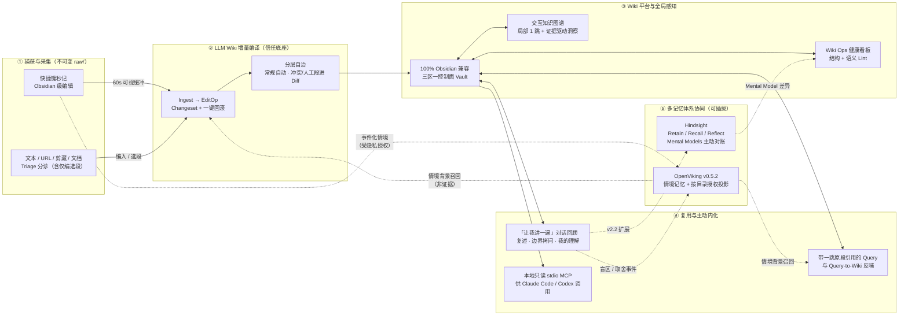

# Wikra v2.0 产品定义书（Product Definition）

日期：2026-11-26  
状态：v2.0 方案定稿（已按 2026-11-26 用户确认更新，待最终放行进入设计稿阶段）  
工作树分支：`redesign/v2-llm-wiki-agent`（独立 worktree，未改动 `main`）  
协同参与：主控 PM（调研访谈、第一性原理诊断与收口裁决）· Claude Opus 5.5 High（Track A 与逐条比对合成）· GPT-6.2-Astra XHigh（Track B 与交叉质询）

> 本文档中凡未经真实日常使用验证的因果判断，均显式标注「待验证假设 Hx」。数值门槛均为拟议验收线，不将页面数、节点数或自动编译次数作为成功指标。

---

## 1. 第一性原理重定义

### 1.1 现版 v1.0 为什么偏离设想（根因诊断）

复盘现版 v1.0 规格与桌面实现后，核心问题不在功能多寡，而在**产品主轴与组织单位写反了**：

1. **主轴跑偏为“日记流水账”**：v1.0 以按天追加的 `YYYY-MM-DD.md` 随手记和单条孤立摘要为中心，Wiki 只是后来附加的左栏目录页签与零散建议抽屉，缺少 LLM Wiki「原材料 → 增量编译 → 互链演进 → 健康巡检 → 问答反哺」的知识复利循环。
2. **缺少可信的自主写入底座**：v1.0 的 Agent 之所以沦为“回答一次即焚的侧边栏搜索框”，根本原因不是缺按钮，而是缺少「结构化编辑操作 + 写前快照 + 一键回滚 + 段落级人工保护」的信任底座——不敢让 Agent 写，它就只能被动聊天。
3. **编辑器手感与知识网络脱节**：现版 `CaptureEditor.vue` 仅做基础标题/列表/引用装饰，缺少 `[[wikilink]]` 实时模糊补全、Frontmatter 属性面板、反链上下文、大纲、表格/Callout/图片粘贴等 Obsidian 级心流要素。
4. **外部输入通道断层**：v1.0 暂缓了文本/链接采集，导致日常高价值的技术长文与网页无法落入不可变原料层参与编译。
5. **图谱、看板与记忆协同缺位**：既看不见知识版图中的健康风险、枢纽与空白，也让 OpenViking 沦为单向同步备份，未与本地 Wiki 形成清晰的语义分工。

### 1.2 本质问题与核心验收单位

一次个人知识工作至少包含四个不同权威来源的层次：**当时收到了什么（原文）**、**据此作出什么判断（结论与证据）**、**该判断适用于什么条件（边界与演进）**、**下次遇到类似问题时本人能否调用并解释它（复用与内化）**。

个人知识库之所以普遍失败，不是因为“记不下来”，而是因为**人工归档、互链、更新与找矛盾的簿记成本，增长速度远高于知识复用价值**；而简单交给 LLM 代管又会引发两大新陷阱——**可信度崩塌**（写得流畅却不敢引用、静默覆盖人工判断）与**理解幻觉**（Wiki 知道 ≠ 我真懂）。

因此，v2.0 要解决的本质问题是：

> **在人始终掌握判断权与证据溯源权的前提下，把知识簿记外包给 Agent，将零散想法与外部材料持续编译为可信、互链、可追溯的本地 LLM Wiki，并在下一次真实评审、设计或学习场景中被本人与外部 AI 工具顺畅调用。**

**唯一核心验收单位**：不是“保存了多少条”或“编译了多少页”，而是**下次遇到真实问题时，能否快速找到、核实并真正用上以前积累的判断（且清楚其依据和适用边界）**。

### 1.3 一句话产品定位与核心隐喻

- **一句话定位**：**Wikra v2.0 是一款 Windows 本机优先的个人 LLM Wiki 知识工作台与 Agent——将你的随手记和外部采集持续编译为 100% 兼容 Obsidian 的互链 Markdown 知识库，通过 Wiki Ops 看板、交互图谱、对话回顾与多记忆体系协同，让知识真正复利并内化为你的判断力。**
- **核心隐喻**：**IDE 增量编译器 + 受控机器人协作者（Trust Substrate）**

| 软件工程概念 | Wikra v2.0 映射 | 关键边界约束 |
|---|---|---|
| 源码（不可变输入） | `raw/`（快记、剪藏、链接收据、文档） | Agent 永不改写或删除原料 |
| 增量编译器 | `Ingest` 工作流（输出结构化 `EditOp`） | 不整页重写，不设输出页数配额 |
| 活文档（人机共编） | `wiki/`（概念、实体、综论、决策、来源页 + `index.md` / `log.md`） | 人工编辑是一等公民，无全库覆写重生成按钮 |
| 原子提交 / 回滚 | `Changeset` + 写前快照一键逆转 | 回滚不覆写后续人工编辑，历史只追加记录 |
| Pull Request / Merge Conflict | 多页成组 Diff 审阅队列 | 先区分版本/时间演进与真冲突，再请人裁决 |
| CI / Linter & Dashboard | 结构 + 语义 `Lint` 与 **Wiki Ops 看板** | 每张卡片带可执行动词，无单一虚荣健康分 |
| `AGENTS.md` / 贡献指南 | `SCHEMA.md`（人类所有的编译规范） | 规则不能扩大安全授权 |
| 运行时情境记忆 | **OpenViking / Hindsight** 等外部记忆后端 | 提供个人情境与反思，绝不充当 Wiki 事实证据 |

### 1.4 与 Obsidian 的定位关系（已确认 D2）

**独立一站式 LLM Wiki 工作台，同时 100% 兼容 Obsidian Vault 文件格式。**

- 日常 80% 以上的秒记、采集分诊、Wiki 阅读与编辑、图谱洞察、冲突审阅与对话回顾都在本应用完成；
- 随时可以用 Obsidian 直接打开同一目录继续重度写作、白板或使用社区插件——Obsidian 是天然逃生舱，因此编辑器只做“日常写作不想切走”的高频子集，绝不陷入复刻整个 Obsidian 运行时与插件生态的泥潭。

### 1.5 目标用户心智模型（面向 Tommy 个人优先）

面向高密度技术阅读、碎片化记录、重度使用 Git/CI 心智与多 Coding Agent（Claude Code / Codex / Antigravity）的个人研发管理者：

1. **我先记下来**：3 秒唤出、不选分类、不填表、不丢字；
2. **我能看见它被整理到哪里**：每批编译有迹可循，随时可看 Diff、可一键撤回；
3. **涉及取舍与边界时由我决定**：常规簿记安静自动完成，观点冲突与人工段落必须等我拍板；
4. **以后我（以及我的 Coding Agent）能从结论一跳回到当时的依据**：评审、写方案、带团队时拿得出、讲得清、用得上。

---

## 2. 跨领域调研与核心设计吸收

| 借鉴领域 | 代表方案 | 吸收到 v2.0 的具体机制 | 刻意拒绝的反模式 |
|---|---|---|---|
| **LLM Wiki 原生范式** | Karpathy LLM Wiki Gist、OpenKnowledge、`llm_wiki`、MindWiki | `raw / wiki / SCHEMA` 三层结构、`index.md` / `log.md` 锚点、`Ingest / Query / Lint` 三原语、Agent Activity 轨迹与本地只读 `stdio` MCP 暴露 | 拒绝无保护全盘覆盖写入；拒绝两跳纯摘要引用导致的条件失真 |
| **PKM 与空间认知** | Obsidian + Bases、Tana、Heptabase、InfraNodus | CodeMirror 6 Live Preview、`[[wikilink]]` 双链与 Frontmatter 属性驱动视图、局部 1 跳聚焦视图、证据驱动的结构性空白提问 | 拒绝全局“毛线球”装饰图谱；拒绝首版复刻 Obsidian 插件运行时或无限画布 |
| **认知科学与学习系统** | Readwise Reader、SuperMemo 渐进阅读、Karpicke & Blunt 检索练习、费曼技巧、NotebookLM | 收件箱分诊（Triage）窄入口、长文分次渐进编选段、强源依据问答、「让我讲一遍」遮答复述 + 边界拷问 + 变式迁移 | 拒绝全库强制制卡/刷题打卡；拒绝由 AI 给用户打“已掌握”分数 |
| **Agent 记忆体系** | OpenViking v0.5.2、Hindsight（vectorize-io）、Zep/Graphiti | 显式知识（Wiki）与情境记忆（Memory）语义解耦；OpenViking 分层加载 L0/L1/L2；Hindsight `Retain / Recall / Reflect` 与 Mental Models 对账思路 | 拒绝机械全库镜像；拒绝检索结果回灌形成自引用回音室；拒绝把记忆直接当 Wiki 证据 |

---

## 3. 五大核心支柱全景



| 支柱 | 一句话职责 | 核心差异化设计 |
|---|---|---|
| **① 快速笔记** | 零摩擦接住个人观察 | `Win+Alt+N` 隐藏复用浮窗、与主窗共用 CM6 Live Preview 内核、一条一文件不可变落盘、60 秒不顺延可视缓冲 + 忙时合批 |
| **② LLM Wiki 平台（看板 + 图谱）** | 让知识结构与健康风险一目了然 | 极简 4 入口工作台、以“阻塞判断的审阅项与可执行告警”为核心的 Wiki Ops、默认 1 跳局部图 + 点边原段 + 键盘等价列表 + 降噪全局图 |
| **③ 知识采集** | 接住外部材料同时防止污染 Wiki | 区分“我的观察”与“待判断材料”；支持 URL 收据与正文抓取、登录墙透明降级、Triage 窄入口（含长文渐进「仅编选段」与未触碰 14 天静默归档） |
| **④ LLM Wiki Agent** | 在信任边界内主动编译、巡检与陪伴内化 | `EditOp` 确定性写入协议、每周 15 分钟审阅预算、一跳原段短引、先区分版本演进再判真冲突、Query-to-Wiki、「让我讲一遍」对话回顾与只读 `stdio` MCP |
| **⑤ 多记忆体系协同** | 补齐跨会话个人情境与认知反思 | 显式知识与情境记忆严格分工、证据隔离防回声室、单写多读、默认关闭全库镜像与快记全文外发、全链路端点接收方声明、兼容 OpenViking 与 Hindsight |

---

## 4. 核心领域模型与 100% Obsidian 兼容 Vault 契约

### 4.1 三区一控制面（新建开箱即用 + 兼容任意已有 Obsidian Vault）

本产品是**独立、通用的个人 LLM Wiki 桌面应用**，不绑定任何特定的历史知识库目录。支持两种启动方式：
- **新建空白 Vault（默认推荐）**：在用户指定的任意空目录自动初始化标准目录结构，开箱即用，并随时可用 Obsidian 直接打开同一目录；
- **接入已有 Obsidian Vault（可选）**：当用户选择打开一个已有的本地 Markdown / Obsidian 文件夹时，不搬移、不改动任何已有文件，通过应用私有映射配置划定只读区与可编译区。

| 分区 | 典型内容 | 人类 | 应用内 Agent | 外部 Agent（经 MCP） |
|---|---|---|---|---|
| **Raw 区（不可变原料）** | 快记、网页剪藏、链接收据、导入文档、附件 | 新建、显式归档/移入回收站 | **只读**（永不改写/删除） | 默认不可见；按文件夹授权只读；Phase 3 可追加原料进收件箱 |
| **Wiki 区（人机共编活文档）** | `index.md`、`log.md`、概念页、实体页、综论页、决策页、来源元数据页 | 自由编辑（修改段落受保护） | 按 `EditOp` 与分层自治规则写入 | Phase 1 只读（含 `wikra_pending_conflicts` 警告）；Phase 3 仅提交提案进审阅 |
| **Human 区（存量人工目录，接入旧库时生效）** | 用户已有 Vault 中的既有项目/日记/个人笔记目录 | 自由编辑 | **只读**（可索引、被引用或手动选段送编译） | 只读（需授权） |
| **控制面 `.wikra/`** | `state.db`、写前快照、草稿、目录映射配置 `config.json` | 无需手动编辑 | 应用私有（`.` 开头，Obsidian 默认忽略） | 不可见 |

**默认目录结构（新建 Vault 默认生成；接入已有 Vault 时通过 `.wikra/config.json` 做逻辑目录映射，绝不搬移或修改用户存量文件）**：

```text
<vault>/
├── SCHEMA.md                      # 人类所有：纯编译规范文档（页型、命名、引用与写作约定）
├── raw/
│   ├── notes/YYYY/MM/YYYYMMDD-HHMM-<slug>.md   # 一条快记一文件（不再按天追加；兼容读历史每日文件）
│   ├── clips/YYYY/MM/<slug>.md                 # 网页剪藏与链接收据（重抓生成 .v2.md 并标注 supersedes）
│   ├── docs/YYYY/MM/<slug>.md                  # 文档提取文本（原件存 raw/assets/）
│   └── assets/                                 # 粘贴图片与原始附件
├── wiki/
│   ├── index.md                   # 按主题/类型维护的入口目录
│   ├── log.md                     # 只追加的编译、审阅裁决与回滚日志
│   ├── sources/                   # 来源元数据与共同来源归组页（非证据中转）
│   ├── concepts/                  # 概念页
│   ├── entities/                  # 实体页（项目、系统、人、工具）
│   ├── syntheses/                 # 综论页（含 Query-to-Wiki 沉淀）
│   └── decisions/                 # 决策页（核心保护区，默认任何实质改写进审阅）
├── <用户已有目录...>               # 仅接入已有 Vault 时存在：默认归入 Human 只读区，原样保留
└── .wikra/
    ├── state.db                   # SQLite：FTS5、链接图缓存、Changeset、审阅、分诊、段落基线快照、出站队列
    ├── snapshots/                 # 写前文件快照（供一键回滚）
    ├── drafts/                    # 未提交草稿
    └── config.json                # 仓库级非敏感配置（含目录映射、端点偏好；密钥一律存 Windows 凭据管理器）
```

### 4.2 最小核心领域对象与数据权威归属

| 领域对象 | 真相权威位置 | 丢失/损坏恢复策略 |
|---|---|---|
| `Source / SourceRevision`（原料与修订版） | `raw/` Markdown 与附件 | 不可变；补抓/新版新建文件并链接 `supersedes` |
| `WikiPage`（正文结论、适用条件与一跳脚注） | `wiki/` Markdown | 纯文本可读可搬迁；外部编辑始终受尊重 |
| `Link / Backlink / FTS5 / GraphIndex` | `state.db` 派生表 | 可随时从 Vault Markdown 全量无损重建 |
| `Changeset / EditOp / Snapshot` | `.wikra/` + `log.md` | 丢失仅失回滚现场，`log.md` 仍留可读演进史 |
| `ReviewItem`（多页冲突集 / 高风险提案） | `state.db` + 对应页 `wikra_pending_conflicts` | 审阅裁决同步写入 `log.md` |
| `TriageItem`（阅读位置、已编选段、分诊态） | `state.db` | 不回写污染 `raw/`；损坏时可按是否已被引用启发式重建 |
| `ReviewSession`（回顾原话、自评、提醒日） | `state.db` | 不污染 Markdown；经确认的新洞察写入该页 `## 我的理解` |
| `MemoryBinding / Outbox` | 外部记忆服务 + `state.db` 发件箱 | 凭据严格存 Windows 凭据管理器，绝不落盘 |

### 4.3 100% Obsidian 兼容与往返保真红线（工程底线）

1. **接库只做加法、不侵入用户文件**：新建 Vault 自动创建标准结构；打开已有 Obsidian Vault 时先预览目录映射，遇已有同名 `SCHEMA.md`、`index.md`、`log.md` 逐项确认绑定绝不覆写。所有目录映射统一存于 `.wikra/config.json`，`SCHEMA.md` 保持纯粹的编译规则文档。
2. **往返保真（Round-trip Fidelity）**：保存局部改动时绝不重排未编辑段落、Frontmatter 未知键与键序、换行符（CRLF/LF）、缩进、`.obsidian/`、`.base`、Canvas、Dataview 代码块、块引用 `^id`、嵌入 `![[...]]` 与注释 `%%...%%`。
3. **一跳原段短引契约**：Wiki 正文结论通过标准 Markdown 脚注一跳指向 `raw/` 文件/标题锚点并附 1–2 句**逐字短引**（例如 `[^s1]: [[raw/clips/2026/11/proto-v2#重连条件|协议 v2 重连条件]] —— “仅在服务端返回确认事件编号后允许从检查点续传。”`）。Rust 侧写盘前校验短引确实存在于该来源修订版中，不存在则拒绝落盘；`wiki/sources/` 负责集中存放作者、版本、方法及**共同来源归组**，防止转载/多份摘录被误判为独立多源印证。

---

## 5. 明确的非目标（Non-Goals）、待验证假设与风险防线

### 5.1 本期明确不做（Non-Goals）

- 不做 Obsidian 插件运行时、Canvas 空间排版、Dataview 查询执行引擎、像素级主题市场复刻；
- 不做多用户团队协作、权限平台、企业级项目管理看板（待办回归页面原生 `- [ ]`）；
- 不做强制每日清零/连胜打卡的卡片式背词软件（FSRS 延后至实证有需求再试点）；
- 不做绕过登录墙/付费墙的抓取（不读浏览器 Cookie、不跑反爬模拟）；
- 不做自建向量数据库、图数据库、分布式 2PC 事务、父目录常驻句柄锁或 NTFS 卷绑定；
- 不做移动端与自研云同步引擎（兼容用户现有云盘/Git，但明确识别并隔离同步冲突副本）。

### 5.2 核心待验证假设清单（Assumptions to Validate）

| 编号 | 待验证假设 | 量化验证方式 | 触发收缩的砍刀线 |
|---|---|---|---|
| **H1** | `EditOp` 分层自治 + 审阅预算能让维护成本低于人工维护，且结论可放心引用 | 2 周实测统计自动 Changeset 回滚率、每周审阅耗时与真实复用中查证次数 | 自动回滚率 > 15%，或连续 2 周超过 15 分钟/周审阅预算 → 冻结自动落盘先修编译质量 |
| **H2** | 本地只读 `stdio` MCP 能让 LLM Wiki 在真实 Coding Agent 工作流中产生高价值复用 | 3 个确实依赖旧知识的真实 Codex / Claude Code 任务 | 找对结论、保留限定条件并给出可打开出处的任务 < 2/3 → 暂不投入 MCP 写入扩展 |
| **H3** | Triage 四动作（含仅编选段）+ 未触碰 14 天静默归档能挡住污染且不造成积压负罪感 | 观察收件箱积压趋势与自动归档后 7 天内手动恢复率 | 7 天内恢复率 > 10% → 延长自动归档阈值至 30 天；若长期积压则削减预分诊提示 |
| **H4** | 1 跳局部图 + 证据驱动的 Hub/孤页/Gaps 能发现普通搜索找不到的有用联系 | 2 周内记录因图谱触发的实际查证、补证或修订案例 | 有效案例 < 2 条 → 冻结图谱深化投入，不立项 Louvain 社区发现 |
| **H5** | 「让我讲一遍」遮答复述 + 边界拷问能暴露“以为懂了其实没懂”并促进迁移 | 2 周内自愿发起次数与写回 `## 我的理解` 次数 | 自愿使用 < 3 次或写回 0 次 → 撤出首页入口，降为页面菜单动作，不立项 FSRS |
| **H6** | 外部记忆（OpenViking / Hindsight）情境召回在真实问题中优于“仅本地 Wiki” | 同题隐藏标签做「仅 Wiki vs Wiki + 记忆」盲评对照 | 盲评无显著新增准确情境或引入噪声/重复 → 默认仅本地 Wiki，记忆仅保留对话可选召回 |

### 5.3 魔鬼代言人 Top 3 失败风险与反脆弱设计

| Top 失败风险 | 最早预警信号 | 产品反脆弱防线 |
|---|---|---|
| **1. 编出“看起来很对却不敢引用的漂亮文字”**（省略适用条件、同源多份摘要伪造印证、换模型后风格漂移） | 用户每次都要重读整篇原文才敢下结论；一条结论挂 3 个引用实为同一原稿 | 一跳逐字短引 + Rust 写盘前存在性硬校验；来源页共同来源归组；一键标记“证据不足”追踪受影响页；v2.1 换模型自动暂停自动写盘并用 10 份合成金样本回放校偏 |
| **2. 用户从思考者退化成“Agent 的值班审稿人”**（低价值提案、假冲突、Inbox 堆积耗尽耐心） | 快捷窗仍在用，但主工作台长期不开；审阅与分诊卡片被连续略过 | 每周 15 分钟审阅预算作为总节流阀（超限按 EditOp 类型降级，绝不由 LLM 自评）；先区分版本/时间演进再判真冲突；未触碰项 14 天静默归档；进行中长文永不过期 |
| **3. 范围膨胀重演“样样 60 分”，或未授权外发导致隐私失控** | 迟迟拿不到真实复用信号；未注意端点性质导致私人笔记误发往共享/第三方服务 | 严格三阶段完整产品迭代推进（每阶段形成端到端可用闭环）；全链路端点（自定义 OpenAI 兼容模型/网关、记忆服务、MCP）显式展示目的地与发送粒度，默认先聚焦本地 OpenViking |

---

## 6. 真实价值验证口径（1 周基线 + 2 周对照）

- **工程发布硬底线（任一违规即阻断发布）**：
  - 改写或删除 `raw/` 次数 = **0**；静默覆盖人工编辑次数 = **0**；未授权外发次数 = **0**；Callout 清理残留 = **0**；
  - Windows / WebView2 + 真实微软拼音输入法下热唤出可输入 P95 ≤ **300 ms**，组词期 `Esc` 绝不误提交，保存失败不锁只读、不死锁关窗；
  - 在代表性 Obsidian Vault 副本上与 Obsidian 交替往返编辑 ≥ 50 页无格式漂移、无未知 Frontmatter/插件块丢失。
- **日常复用对照实验（单人实证，不报夸大百分比）**：
  1. 先用现有 Obsidian + 搜索习惯记录 1 周真实工作查证基线（记录问题、找回可用原段耗时、是否敢用）；
  2. 再以 v2.0 连续使用 2 周，统计至少 5 个自然发生的评审/设计/讲解问题，核验其中至少 3 个是否基于 Wiki + 一跳原文完成真实决策，并同步审计每周审阅耗时是否控制在 15 分钟预算内。
