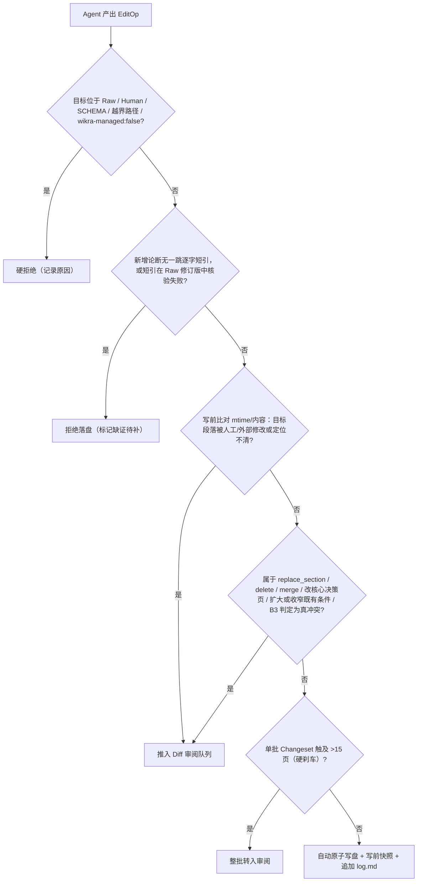

# Wikra v2.0 需求设计规格书（PRD）

日期：2026-11-26  
状态：v2.0 方案定稿（已按 2026-11-26 用户确认更新，待最终放行进入设计稿阶段）  
前置文档：[产品定义书 v2.0](PRODUCT-DEFINITION-v2.md) · [多模型逐条比对与决策归因矩阵](MULTI-MODEL-SYNTHESIS.md)

---

## 1. 信息架构与交互形态总览

### 1.1 窗口体系

| 窗口 | 职责边界 | 行为与尺寸约定 |
|---|---|---|
| **独立快捷窗** | 零摩擦快记与剪贴板/URL 快速投入 | 隐藏窗口常驻复用，支持无边框置顶（约 600×340），失焦不自动关闭防误触丢字；提交后交还 Windows 原前台窗口焦点，仅当用户显式操作时才跳入主工作台 |
| **主工作台** | 一站式 Wiki 浏览、编辑、Ops、采集、图谱与审阅 | 最小 1100×700，适配 Windows 100% / 125% / 150% DPI；重启恢复上次打开的主题与位置 |
| **系统托盘** | 常驻进程、编译状态与只读 MCP 运行载体 | 角标提示待审阅数；右键菜单提供「新建笔记 / 打开工作台 / 暂停或恢复编译 / 退出」 |

### 1.2 主工作台信息架构（彻底告别 v1.0 流水账与七栏平铺）

```text
┌────┬──────────────────┬─────────────────────────────────┬────────────────────┐
│ 主 │ 左侧上下文列表     │ 中央工作区（多标签页）             │ 右侧可折叠面板      │
│ 导 │                  │                                 │                    │
│ 航 │ · 工作台：快捷筛选 │ · Wiki 编辑器（Live Preview）     │ 页签：              │
│ (4)│ · 知识库：目录树/ │ · 工作台首页（Wiki Ops）          │ 1. 上下文           │
│    │   类型/标签/搜索  │ · 收件箱（原文预览 + 选段分诊）    │   (反链·大纲·属性·  │
│ 🏠 │ · 收件箱：待分诊  │ · 多页冲突审阅 Diff（并排/行内）  │    局部 1 跳图)     │
│ 📚 │ · 图谱：集群/过滤 │ · 交互图谱主画布 + 键盘关系列表   │ 2. 对话             │
│ 📥 │                  │                                 │   (当前页+可选1跳)  │
│ 🕸 │                  │                                 │ 3. 活动             │
│ ── │                  │                                 │   (Changeset·回滚)  │
│ ⚙  │                  │                                 │                    │
└────┴──────────────────┴─────────────────────────────────┴────────────────────┘
```

- **4 项极简主导航**：**工作台**（默认首页：问题搜索 + 继续上次主题 + Wiki Ops 核心卡片）、**知识库**（`index.md` 入口、目录树、按类型/标签/虚拟日视图筛选）、**收件箱**（外部采集预览、阅读进度与 Triage 分诊）、**图谱**（v2.1：全局图与关系清单）。设置收拢至底部齿轮；「审阅」不占主导航，从工作台阻塞卡片角标或受影响 Wiki 页直接以**中区标签页**打开（保证宽屏左右并排看多页 Diff，窄窗 `<1280px` 自动切上下行内 Diff）。
- **右侧面板自适应规则**：包含「上下文 / 对话 / 活动」3 个页签。打开 Wiki 页时默认展开「上下文」，在工作台首页时默认收起，并持久化记住用户手动开合状态。对话默认仅附带**当前页**为上下文，1 跳邻居以可点击 chip 呈现，避免宽泛反链悄悄扩大外发范围。
- **视觉密度边界**：首屏不放全局图谱；工作台卡片最多 6 张，无待办时不强行凑数；按天浏览退化为知识库内筛选视图；待办回归页面原生 `- [ ]`。

### 1.3 快捷键规范（尊重现版与 Obsidian 肌肉记忆）

| 范围 | 快捷键 | 行为 |
|---|---|---|
| 全局 | `Win+Alt+N`（沿用现版，冲突可切换 `Ctrl+Alt+N` / `Ctrl+Alt+M`） | 唤出独立快捷窗，焦点直落正文 |
| 全局（选配） | 默认不绑定（设置内可自选如 `Ctrl+Alt+V`） | 静默捕获剪贴板 URL/文本进收件箱并轻提示 |
| 快捷窗 | `Ctrl+Enter` | 原子保存至 `raw/notes/` 并入编译队列（60s 可视缓冲） |
| 快捷窗 | `Ctrl+Shift+Enter` | 保存并跳过缓冲立即编译（可选同时在主窗打开） |
| 快捷窗 | `Esc` | 严格顺序：① 交给中文 IME → ② 关补全浮层 → ③ 隐藏窗口并保留持久化草稿（**绝不静默提交**） |
| 主工作台 | `Ctrl+O` / `Ctrl+P` / `Ctrl+Shift+F` | 快速切页 / 命令面板 / 全库检索 |
| 主工作台 | `Ctrl+S` / `Ctrl+E` / `Alt+←` | 保存当前页 / Live Preview 与源码切换 / 返回上一阅读位置 |
| 主工作台 | `Ctrl+J` / `Ctrl+G` | 开关右侧对话面板 / 打开图谱（v2.1） |

---

## 2. FR-01｜快速笔记与 Obsidian 级 Markdown 体验

### 2.1 统一编辑器内核（CodeMirror 6 + Lezer Live Preview）

快捷窗与主工作台共享同一套 CodeMirror 6 编辑内核、双链解析、撤销栈与中文 IME 保护（复用并升级现版 `CaptureEditor.vue` 与 `captureMarkdown.ts`），仅按窗口裁剪外围面板。

| 能力分级 | 具体需求 | 目标版本 |
|---|---|---|
| **Core（必须到位才算“像 Obsidian”）** | 光标离开语法片段时原位渲染、移入时显露标记；标题、加粗/斜体/删除线、列表与原生 `- [ ]` 复选框、引用、行内代码与围栏代码高亮；`[[` 实时模糊补全（按标题与 `aliases`，同名展示路径写无歧义链接，支持 `#标题` 与 `\|显示名`）；未解析链接样式区分且 `Ctrl+Click` 可新建页；`#tag` 识别；Frontmatter 结构化属性面板（标量、列表、日期、别名，支持切回原始 YAML，未知键与顺序原样保留）；表格与 Callout（`> [!note/question/warning]`）原位渲染；剪贴板粘贴图片落盘 `raw/assets/` 并插入相对路径引用；文内查找、标题大纲、反链上下文面板、`Ctrl+E` 源码切换 | **v2.0** |
| **Enhanced（显著增益）** | 未链接提及（Unlinked Mentions）一键转链；`![[note]]` 只读嵌入预览；KaTeX / Mermaid 渲染；表格键盘 Tab 跳格辅助 | **v2.1** |
| **Optional（按需）** | Vim 键位模式、中区分屏双栏 | **v2.2** |
| **Explicitly Out** | Obsidian 插件执行、Canvas 编辑器、Dataview 脚本执行、任意 HTML/JS 执行 | 不做 |

**安全基线**：预览区经严格白名单清理，禁止脚本执行；工作区本地相对路径图片直接展示；远端外链图片默认拦截并提供按来源/域名显式放行。

### 2.2 快捷窗落盘、IME 防丢与编译触发契约

1. **一条快记一个不可变文件**：提交后写入 `raw/notes/YYYY/MM/YYYYMMDD-HHMM-<slug>.md`（最小 Frontmatter：`created`、`type: note`、`tags`），保留原位读取与搜索历史 `YYYY-MM-DD.md` 每日文件的兼容能力。
2. **严格落盘与防丢底线**：
   - 中文 IME 组词期间，拦截 `Enter`、`Ctrl+Enter`、`Esc` 与补全快捷键，待 `compositionend` 文本同步后再响应；
   - 文本防抖写入 `.wikra/drafts/`；提交时先持久化图片等附件，再原子替换写入 `.md`，收到磁盘确认后才清空草稿并隐藏窗口；同草稿重试幂等不生成重复文件；
   - 磁盘无权限或写满时，**绝不将编辑器锁为只读、绝不死锁关窗或托盘退出**，保留正文并提供「重试 / 复制全文 / 留草稿隐藏」。
3. **60 秒不顺延可视缓冲 + 忙时合批**：
   - `Ctrl+Enter` 落盘后立即可被 FTS5 搜索，并进入后台编译队列，进入**默认 60 秒（30–180 秒可配）可视缓冲窗口**；
   - **不顺延规则**：缓冲倒计时从批次内第一条快记启动，窗口内后续快记合入同一批次但不顺延截止时间，防止连续记录导致首条饥饿等待；状态栏始终清晰呈现 `已保存 / 待编译(0:42) · 立即编译 / 编译中 / 已编入`；
   - 后台编译队列忙时，自动将尚未开工的排队快记合并为同一批次；用户可单次选「仅保存」或用 `Ctrl+Shift+Enter` 跳过等待立即编译；
   - 快捷窗中粘贴普通文本内含 URL 不触发整页抓取；若仅粘贴单个独立 URL，提供轻提示「作为链接采集进入收件箱 / 作为文本保留」。

---

## 3. FR-02｜知识采集、分诊（Triage）与原文版本管理

### 3.1 二元分流原则

系统在入口处只做一次有实质意义的区分：**「我的观察（快记）」**默认跳过分诊进入编译缓冲；**「外部待判断材料（采集）」**一律先落入 `raw/` 不可变存档并进入**收件箱（Triage）**，保持正式 Wiki 的入口比 Raw 窄。

### 3.2 支持的输入形态与抓取降级

| 输入源 | 首次保存行为 | 降级与去重规则 | 版本 |
|---|---|---|---|
| **粘贴文本 / 选区** | 正文、可选出处与用户批注分离保存于 `raw/clips/`，批注明示归属用户 | 正文哈希精确去重，命中时提示查看已有条目 | v2.0 |
| **网页 URL** | 先原子写下链接收据；后台抽取正文（Readability 风格转 Markdown）并本地化必要图片至 `raw/assets/`，写入完整快照（`fetch_status: full`） | 遇登录墙、401/403、反爬/人机验证、超时或正文过短时，**不尝试绕过**，保留 `fetch_status: stub` 链接收据并提示“在浏览器打开后复制正文补全”；规范化 URL（仅剥离明确追踪参数 `utm_*`）去重，同 URL 正文实质变化时新建 `.v2.md`（标注 `supersedes`） | v2.0 |
| **本地文档** | `.md` / `.txt` / `.html` 拖入直接存档 | 保留原件路径与版本 | v2.0 |
| **PDF / DOCX** | 原件入 `raw/assets/`，提取带页码/段落定位的可检索文本入 `raw/docs/` | 扫描件或提取失败保留原件并支持手动贴摘录，不做重型 OCR | v2.1 |
| **剪贴板热键（选配）** | 显式按下自选热键直接入收件箱并记录来源窗口标题 | 托盘轻提示确认收下内容，不抢焦点 | v2.0（选配） |

### 3.3 Triage 四动作、渐进选段与防积压机制

1. **四大标准动作**（支持键盘快速处理）：
   - **编入 Wiki**：整篇送入 `Ingest` 编译；
   - **仅编选段**：用户在预览区勾选与当前问题相关的一段或多段文字送入编译，**保留当前阅读位置与已编范围**，长文可分多次渐进消化（未授权整篇外发时，远端模型仅接收所选段落）；
   - **稍后**：保留在收件箱继续阅读；
   - **仅存档（`Enter` 默认动作）**：留在 `raw/` 供全文检索，不污染正式 Wiki（用户另可显式移入系统回收站）。
2. **受隐私约束的预分诊辅助**：仅在用户已授权对应预分诊模型接收方与整篇发送粒度时，生成 3 行摘要、与现有 Wiki 的关联度及高亮推荐动作并指向值得读的原段；未授权时只展示本地元数据与原文预览。
3. **防积压规则（区分“未触碰”与“进行中”）**：
   - **未触碰项**（从未打开、无选段、无批注）：满 **14 天**自动静默转为「仅存档」（不动 `raw/` 原件，每周汇总提示“本周自动存档 N 条，支持一键恢复”）；
   - **进行中项**（已打开阅读、留批注或有选段进度）：**永不自动归档**，保护长文跨周渐进阅读体验；
   - 首页工作台最多推荐 1 条最重要待分诊材料，角标仅统计本周待决项，避免制造收件箱焦虑。

---

## 4. FR-03｜LLM Wiki 平台、Wiki Ops 健康看板与交互式知识图谱

### 4.1 知识库视图

- 默认以 `wiki/index.md` 为人类可读导航骨架，同时支持按**文件目录树**、**页面类型**（`concept / entity / synthesis / decision / source`）、**标签/属性**与**虚拟按日视图**（聚合每日快记与编译产出）切换浏览；
- 支持页面重命名全库双链重构（IDE 式 Rename Refactor，作为一个可回滚 `Changeset`）；
- 兼容已有库中 `.base` 等文件原样留存，并在本应用内提供基于 Frontmatter 属性的轻量筛选视图。

### 4.2 Wiki Ops 健康看板（工作台默认首页）

原则：**每张卡片必须带可执行动词；不设单一“健康分”；除真冲突外允许静音/忽略。**

| Ops 卡片 | 展示信息 | 卡片直接动作 | 版本 |
|---|---|---|---|
| **阻塞判断的审阅项（最高优先）** | 多页冲突集、核心决策页改写、人工段落重叠提案数量与摘要 | 一键在中区标签页打开并排 Diff 裁决 | v2.0 |
| **待消化收件箱** | 最多推 1 条最相关/待补正文材料 + 本周待决计数 | 预览 / 仅编选段 / 仅存档 / 补全正文 | v2.0 |
| **编译活动与预算** | 运行中/缓冲倒计时任务、最近 24h 实质变化的 Changeset 摘要、失败任务、本周审阅耗时与预算进度 | 立即编译 / 暂停队列 / 查看逐页 Diff / 一键回滚 / 重试 | v2.0 |
| **结构与语义 Lint 告警** | 结构规则（确定性零成本）：断链、孤页、`index.md` 漏项、同步冲突隔离副本；语义规则（定期/手动）：疑似矛盾、到期复核（决策写明复核日或依赖版本变更）、近义重复页 | 定位段落修复 / 忽略并记理由 / 生成修复提案 / 标记仍适用 | 结构 v2.0 增量；完整看板与语义 v2.1 |
| **条件回顾卡** | 仅当存在到期「需再看」项时显示 1 张卡（无打卡、无连胜） | 启动「让我讲一遍」/ 延后 / 静音 | v2.1 |

### 4.3 交互式知识图谱（v2.1，克制实用防毛线球）

1. **局部图优先（右侧上下文页签）**：默认从当前 Wiki 页向外展示 **1 跳关系**（按需展开第 2 跳），用清晰视觉区分三类边——**证据引用（至 Raw）**、**显式双链**、**反向链接**；点击任意一条边直接预览形成该关系的原文段落；图谱旁始终提供**等价的可键盘导航关系列表**。
2. **降噪全局图（主导航「图谱」页）**：
   - **按页面角色折叠高连接枢纽**：由 `SCHEMA.md` 声明索引页（`index.md`）、日志页（`log.md`）与模板角色并默认折叠排除，绝不按文件名硬编码误伤实质文档；
   - 默认只显示 Wiki 区，按**页面类型与标签**过滤（不按易反映归档时间而非知识结构的目录树聚合）；超过 **2,000 个节点**时自动提示切回局部视图或筛选子集；
   - Louvain / Leiden 社区发现延后至 v2.2，须先由 H4 实测证明图谱已产生有效查证/修订行动后再立项。
3. **证据驱动的三类洞察（每个洞察必须挂可执行问题与动作）**：
   - **Hub 核心枢纽**：按被不同主题页实质引用的入度识别（排除索引/导航链），一键查看「哪些判断依赖本页」或设为 `wikra-core`；
   - **孤页**：区分合理“独立参考”与真正遗忘页，一键搜索全库提及段落决定补链或标记独立参考；
   - **Structural Gaps（结构性空白）**：仅当两组页面存在明确**共同实体或共同问题**且显式连接稀少时提出具体桥接问题（例：“断线恢复与消息去重都依赖事件编号，恢复后如何识别已展示片段？”），一键发起 Query 查证或标“无关”，禁止仅靠共享泛泛法规/总则制造假空白。

---

## 5. FR-04｜LLM Wiki Agent 核心能力

### 5.1 结构化写入协议（`EditOp`）与 `Changeset`

Agent **禁止整页重写文件**，只能输出由 Rust 侧校验并执行的原子操作列表 `EditOp`：
- `create_page` / `append_section` / `replace_section` / `delete_section` / `add_link` / `add_alias` / `set_frontmatter_key` / `insert_callout` / `propose_merge`

每批关联操作封装为一个 `Changeset`，持久化记录：触发来源（及修订号）、编译模型 ID、规划理由、涉及页面的写前基线哈希与内容快照、逐项风险判定结果与执行状态（`queued | running | partial_pending_review | applied | failed | reverted`）。

### 5.2 分层自治精确判定规则（确定性规则优先，严禁 LLM 自评放行）



- **默认自动落盘范围**：在授权 Wiki 目录新建带有效一跳短引的来源页或新概念/实体页；`add_link` / `add_alias`；在非人工修改区域 `append_section` 追加有新证据支持的段落；维护 `index.md` 与 `log.md`。
- **必须进审阅范围**：一切 `replace_section` / 删除 / 合并拆分；一切改变既有断言强度或适用条件的修改；一切触及人工修改段落的重叠操作；一切指向 `decisions/`、`type: decision` 或 `wikra-core: true` 核心页的实质改动；单批触及 >15 页的整批刹车。
- **每周审阅预算总节流阀（默认 15 分钟/周，可调）**：连续接近或超出预算时，**按 `EditOp` 类型确定性降级**——先暂停生成 `replace_section` 类优化提案，低优先级提案合并至周摘要；`add_link` 与新建来源页照常运行。绝不依赖 LLM 自评“重要度”过滤提案。
- **段落级人工文本保护**：`state.db` 按段落记录 Agent 上次写入后的基线指纹。用户在 Obsidian 或本应用改动某一段时，仅保护该人改段落（重叠或定位不清进 Diff），同页不重叠段落仍可正常更新，避免“改一个标题导致整页永久降级为只追加”。
- **一键回滚**：按 `Changeset` 逆向执行并恢复写前快照；若目标段落在写入后又被人工编辑，则自动生成保留人工改动的反向 Diff 进入审阅，绝不强行覆盖。回滚动作本身追加记录至 `log.md`。

### 5.3 版本演进识别（B3）与多页成组冲突审阅（Git Merge Conflict 体验）

1. **先判演进，再判冲突**：生成冲突前先核对版本、适用对象与生效时间。若新旧来源分别适用于不同版本或阶段（如“v1 支持离线”与“v2 起取消离线”），归为**条件/版本演进**，按范围并列记录而不打扰用户做假二选一；仅当适用范围重叠且结论不相容时，才触发真冲突审阅。
2. **多页成组审阅**：同一项判断的分歧若同时波及概念页、综论页与决策页，合并为**一个审阅项**（同次 Ingest 中与冲突无关的变更照常自动落盘，不被阻塞）。中区审阅标签页并排呈现：旧判断及一跳原文 vs 新主张及一跳原文 + 受影响页面列表。
3. **三选一（加手动编辑）裁决**：
   - **并存并标注适用范围**（最常用，写清 X 条件下 A 成立、Y 条件下 B 成立）；
   - **采纳新结论**（旧结论标明被取代时间与原因，保留在「演化」节，不抹去历史）；
   - **保留旧结论**（记录理由，同来源同版本不再重复弹窗）。
   裁决结果通过单个 `Changeset` 同步传播至所有受影响页面并记入 `log.md`。
4. **未决分歧的页内警示（T6）**：
   - **默认零正文污染**：在受影响页 Frontmatter 写入可读列表 `wikra_pending_conflicts: ["<断言> 受 <来源> 挑战（审阅 #12）"]`，Obsidian 属性面板可见、MCP `read_page` 原样返回警告字段，裁决后按结构删键清理；
   - **核心决策页受控例外**：仅对 `decisions/`、`type: decision` 或 `wikra-core` 页面，且新证据直接挑战现行结论、不警示会误导实施时，允许在受影响段落旁插入简短受控 Callout；裁决时清理，若该 Callout 曾被人工修改则转 Diff 确认，确保残留为 0。

### 5.4 三大核心工作流（`Ingest` / `Query` / `Lint`）

- **`Ingest`**：读取原料、`SCHEMA.md`、`index.md`、FTS5/链接邻域候选页与经授权的记忆情境 → 生成 `EditOp` 计划 → Rust 逐条核验一跳短引、人工段落与风险规则 → 低风险落盘、高风险成组进审阅 → 更新 `index.md` 与 `log.md` → 触发受影响页增量结构 Lint。重复材料允许输出「无变化」。
- **`Query` 与 `Query-to-Wiki`**：优先查 Wiki 标题/别名/FTS5 与引用链，必要时下钻 `raw/`，并列召回已授权记忆情境。回答明确分层标注：**「Wiki 有据（可一跳直达原段）」/「Raw 原文」/「个人情境（来自记忆，非证据）」/「模型常识补充（未入库）」**。高价值综合回答支持一键「沉淀入 Wiki」，先查已有页再选补充旧页或新建 `syntheses/` 页，走同一 `EditOp` 风险与审阅规则；Wiki 无覆盖时允许保存为待查开放问题。
- **`Lint`**：结构 Lint（断链、孤页、`index.md` 漏项、同步冲突隔离）随文件变更确定性增量运行；语义 Lint（疑似矛盾、到期复核、近义重复页）在 v2.1 定期或手动触发并受预算约束。两周内同类驳回原因出现 ≥3 次时（v2.1），可提议 `SCHEMA.md` 规则补丁进审阅。

### 5.5 对话式回顾与学习：「让我讲一遍」（v2.1）

摒弃系统替用户打“掌握分”和重型刷题牌组，统一收敛为一个 5–10 分钟的自然对话流：
1. **收起答案复述**：围绕单页或一个真实判断提问，允许口语化作答或直接点「还说不清」；
2. **证据核对与边界拷问**：对照一跳原文指出覆盖点与遗漏条件，追问边界反例（如“若没有服务端确认编号，你的方案还成立吗？”），页面无依据处明示「Wiki 未覆盖」并可转待查；
3. **变式迁移**：换一个真实业务场景（可结合已授权记忆情境）要求用户给出判断与理由；
4. **本人自评与轻沉淀**：由用户自选 **「能用 / 需再看 / 暂不关心」**——选「需再看」默认按 **3 / 7 / 21 天**（或自定日期）在首页条件露出 1 张卡；若用户在复述中产生超出原页的新洞察，经本人点击确认后写入该页 `## 我的理解`（永久归人工段落受保护）；暴露的盲区作为事件可选发送至记忆后端；发现 Wiki 原文有误当场发起修订。FSRS 严格留待 v2.2 视 H5 实证后再对标星页试点。

---

## 6. FR-05｜多记忆体系协同（OpenViking / Hindsight）与本地 MCP 生态

### 6.1 语义分工与证据隔离铁律

- **分工原则**：Wiki 承载**可查证的结论、证据与决策依据**；记忆体系承载**个人情境、偏好、经历反思与心智模型**。一条项目裁决在数据流中拆分为两部分：客观依据与适用范围落入 Wiki，经确认的个人取舍理由与当前背景进入记忆后端。
- **证据隔离与防回声室（不可违背）**：
  1. 记忆召回可用于提示上下文、追问角度或标注「与你当前项目相关」，**永远不可充当 Wiki 论断的事实证据**；
  2. 同一原始出处的 Wiki 摘要、OpenViking 投影与 Hindsight 反思统一归入同一来源组，防止伪多源印证；
  3. 对话回答、召回摘要与 Mental Model 绝不因再次被检索而循环 `Retain` 回写；
  4. 用户纠正旧偏好时记录新旧适用时间并停止使用被纠正说法。

### 6.2 统一模型接入与可插拔记忆连接器

#### 6.2.1 自定义 OpenAI 兼容模型与网关接入（Phase 1）
- 全面支持**任意 OpenAI 兼容协议的模型服务或本地/云端网关**（OpenAI、第三方兼容服务商、本地聚合网关或本地 Ollama/vLLM 等）；
- 用户在设置页自定义配置：**Base URL、主编译模型 ID、可选轻模型 ID（用于预分诊/轻量校验，未配则复用主模型）、API Key（存 Windows 凭据管理器，留空保留原密钥）**，并提供一键「测试连接」与真实模型联通反馈；
- 个人快记全文**默认允许**发送给用户已配置并启用的编译模型（支持在设置中一键暂停自动编译，或单条快记选择「仅保存」）。

#### 6.2.2 可插拔记忆连接器（`MemoryProvider`）

```rust
// 概念接口：只抽象最小共同能力 + 显式能力声明，不强行抹平后端差异
trait MemoryProvider {
    fn capabilities(&self) -> ProviderCapabilities; // retain, recall, project_resource, reflect, delete_or_correct
    async fn health(&self) -> HealthStatus;
    async fn retain_event(&self, event: ContextEvent) -> Result<Receipt>;
    async fn recall(&self, query: RecallQuery) -> Result<Vec<MemoryHit>>; // 必带来源标识、时间与后端名
    async fn project_resource(&self, doc: ResourceProjection) -> Result<Receipt>; // 可选
    async fn reflect(&self, topic: &str) -> Result<Option<MentalModelView>>;      // 可选
}
```

- **演进策略（已确认）**：接口层保持后端无关与可插拔，**优先打透本地 OpenViking 接入（Phase 2）**，后续再平滑扩展 **Hindsight** 等其他记忆产品（Phase 3），不绑定单一记忆实现；
- **默认单写多读**：每个工作区最多配置一个默认写入记忆后端，其他已配置后端可按需开启只读召回（召回结果按后端分组展示，不做强行跨后端融合打分）；提供默认 `NullProvider`，无外部记忆服务时本地闭环 100% 可用；
- **本地 OpenViking 适配器（Phase 2）**：
  - 默认对接本机私有 OpenViking 实例（如 `http://127.0.0.1:1933`，支持自定义地址与 API Key）；
  - 情境写入走 `sessions → messages → commit` 抽取 `memories`；
  - `resources` **默认关闭全库镜像**，改为按文件夹或逐文档显式授权投影，召回时沿用 L0（摘要）→ L1（概览）→ L2（详情）按需分层加载，作证必须回到原文版本；
  - Wiki 发生回滚时标记已失效投影并在恢复连接后按 outbox 重放或清理。
- **Hindsight 及其他记忆适配器（Phase 3）**：
  - 一个 Vault 对应一个 `Memory Bank`，直接映射 `Retain / Recall / Reflect`；
  - `Reflect` 仅按需运行且不自动覆写持久 `Mental Model`；支持由用户**主动发起「Mental Model vs Wiki 综论/决策」对账**，将“证据支持 A 但你长期按 B 做”的认知偏差转化为审阅项供本人决定（补证据 / 更新决策 / 确认个人偏好）。

### 6.3 全链路外发透明与隐私护栏（B4 + T9，工程底线）

1. **所有外发出口统一纳管**：涵盖**编译/预分诊 LLM 端点、外部记忆后端、本地 MCP 客户端**。
2. **显式接收方标注（不盲信 `127.0.0.1`）**：因本机代理或聚合网关可能将 loopback 流量转发至远端或多人共享实例，配置端点时由用户标明性质（**本人私有本地 / 共享实例 / 第三方云商**）；对接共享实例时显式二次确认并按文件夹控制范围。
3. **默认最小外发与粒度一致**：
   - 个人快记全文按用户授权发送给已启用的编译模型；发往记忆后端默认仅发送情境事件（话题、意图、裁决理由、学习盲区），关闭全库自动镜像；
   - **发送粒度严格等于授权粒度**：在收件箱只勾选「仅编选段」时，模型仅接收所选段落，不发送未授权的整篇原文；
   - 凭据一律存 Windows 凭据管理器，绝不落盘或入日志；提供可选本地敏感字段正则脱敏开关作为辅助防线。

### 6.4 本地只读 `stdio` MCP Server（v2.0 先行，v2.2 扩展提案）

- **v2.0 交付只读 `stdio` MCP**（显式绑定单个 Vault，无常驻 HTTP 端口与鉴权负担），提供 3 个高价值工具 + 规范 Resource（`SCHEMA.md` / `index.md`）：
  1. `search(query, filters)`：检索 Wiki 标题、别名、FTS5 与引用摘要；
  2. `read_page(path)`：返回正文、一跳脚注、`wikra_pending_conflicts` 警告字段与反链摘要；
  3. `get_evidence(citation_ref)`：将脚注解析为对应 `raw/` 修订版的逐字短引、上下文原段与来源元数据。
- **权限与外发边界**：默认只暴露 Wiki 区与脚注短引，Raw 全文须按文件夹显式授权；外部 Agent 不可通过 MCP 直接覆写文件或读取凭据。v2.2 再按实测需要开放 `raw_add` / `wiki_propose` / `query_to_wiki`（一律进入审阅队列并标明调用方来源）。

---

## 7. 核心端到端旅程、降级矩阵与护栏

### 7.1 五条高频日常闭环

| 旅程 | 最短路径 | 可观察完成标志 |
|---|---|---|
| **J1 秒记入库** | 任意窗口 `Win+Alt+N` → 写观察（支持 `[[` 补全）→ `Ctrl+Enter` 返回原窗口 → 60s 可视缓冲自动编译（或立即编译） | 原文即刻落盘 `raw/notes/` 且 Obsidian 可见；次日从 Wiki 结论一跳直达当时原话，并区分「本人观察」与「已证实证据」 |
| **J2 链接/长文采集分诊** | 粘贴 URL 或文本 → 写收据并抓取正文 → 收件箱预览 → 选「仅编选段」或「仅存档」 | 遇登录墙明示“仅存链接”并支持补贴正文；长文退出保留进度；仅选段内容进入远端模型与编译 |
| **J3 冲突审阅与回滚** | 工作台点击阻塞审阅卡 → 中区并排核对双方原段与受影响多页 → 选「并存并注明适用范围」→ 必要时在活动面板一键回滚 | 多页表述同步一致，原因记入 `log.md`，Frontmatter 警示自动清除；回滚时保留用户后续人工修改 |
| **J4 问答探索与 MCP 复用** | 右栏 Query 发问（或 Codex 通过 `stdio` MCP 调用 `search`→`read_page`→`get_evidence`）→ 核对一跳原段 → 有价值结论点「沉淀入 Wiki」 | 回答清楚区分 Wiki 有据与模型常识；外部 Agent 正确读取限定条件与待决警告，不翻聊天即可复用结论 |
| **J5 主动回顾学习（v2.1）** | 从页内或首页到期卡启动「让我讲一遍」→ 遮答复述 → 边界反例拷问 → 变式迁移 → 自评并确认写入 `## 我的理解` | 暴露至少一处漏掉的条件或盲区；无刷题积压；本人洞察受人工段落保护永不被覆盖 |

### 7.2 降级与抗并发护栏

| 异常场景 | 确定性降级与保护行为 |
|---|---|
| **断网 / 模型不可用 / 预算触顶** | 快记、Live Preview 编辑、本地文档采集、FTS5 检索、图谱、结构 Lint、已有 Diff 审阅与回滚 100% 可用；URL 先存收据；编译任务安静排队并可单项重试 |
| **外部并发编辑与同步盘冲突（B1）** | 每个 `EditOp` 携带基线版本，写前核对 mtime 与内容哈希：不重叠则自动 rebase，重叠则转 Diff 审阅；同步盘冲突副本（`(conflict)`、`-冲突`、`.sync-conflict-` 等）自动隔离，不参与编译 |
| **换模型导致编译行为漂移（B2，v2.1）** | v2.0 起 Changeset 记录模型 ID；v2.1 检测到编译模型变更时，自动暂停自动写盘（暂转纯审阅）并用 10 份**纯合成** Raw 金样本回放比对 `EditOp` 分布与触及页数，偏离超 50% 维持纯审阅直至确认 |
| **记忆后端不可用** | 状态栏静默灰点，事件入 outbox（超 7 天清理并记日志），问答与编译无缝回退纯本地并标注本次范围 |
| **SQLite `state.db` 损坏** | 一键从 Vault Markdown 重建 FTS5、双链与图索引，正文与 `log.md` 零损失 |

---

## 8. 分阶段垂直切片路线图与现有资产复用

### 8.1 现有资产复用策略

沿用现版仓库已验证的工程底座，彻底重构业务单元（从「单条日记摘要」切换为「来源修订版 + `EditOp` 多页 `Changeset`」）：
- **直接复用并演进**：Tauri 2 双窗隐窗复用框架、Windows 全局热键与托盘（`hotkeys.rs`）、系统凭据管理器集成（`platform/windows.rs`）、`reqwest` HTTP 传输、SQLite FTS5 trigram 混合检索（`storage/search.rs`）、`CaptureEditor.vue` IME 组词保护与 `captureMarkdown.ts` Lezer 语法装饰；
- **彻底重构**：数据表 Schema（聚焦 `sources / changesets / review_items / triage_items / paragraph_baselines / review_sessions / memory_outbox`）、主工作台布局与编译执行引擎。

### 8.2 完整产品三阶段迭代交付路线图与质量门禁

已按用户拍板确定交付**完整产品（全部五大支柱）**。为避免五支柱同步铺开导致失控，按三个连续垂直切片阶段稳步推进，每阶段交付后即可端到端投入真实日常使用：

| 阶段 | 核心闭环交付 | 质量门禁与迭代校准 |
|---|---|---|
| **Phase 1（v2.0 核心闭环）**<br>*一份材料改变一个可用判断并在真实任务中复用* | **主干**：新建标准 Vault + 兼容任意已有 Obsidian Vault（映射存于 `.wikra/config.json`）；CM6 Live Preview Core + 快捷窗（`Win+Alt+N`、60s 不顺延缓冲、IME 防丢）；自定义 OpenAI 兼容模型/网关接入（允许快记全文发送）；`EditOp` 增量编译 + `Changeset` + 写前快照回滚 + 段落级人工保护 + B1 并发隔离；**只读 `stdio` MCP（3 工具）**。<br>**完整核心体验**：文本/URL 采集与 Triage 四动作（含仅编选段与 14 天未触碰归档）；B3 版本演进识别 + 多页成组冲突审阅 + T6 Frontmatter 警示；4 入口工作台与核心 Ops 卡；一跳原段 Query 与 Query-to-Wiki。 | **工程底线（零容忍）**：人工文本丢失 = 0、改写 `raw/` = 0、未授权外发 = 0、Callout 残留 = 0。<br>**质量校准**：自动回滚率 > 15% 或连续 2 周超 15 分钟审阅预算 → 优先修编译质量后再继续叠加能力。 |
| **Phase 2（v2.1 完整产品补齐）**<br>*知识图谱、健康巡检、对话学习与本地 OpenViking 协同* | 结构 + 语义 Lint 与完整 Wiki Ops；可交互知识图谱（默认 1 跳局部图 + 点边原段 + 键盘列表 + 角色降噪全局类型/标签图 + 证据驱动 Hub/孤页/Gaps）；「让我讲一遍」对话回顾 + 3/7/21 天轻提醒 + `## 我的理解`；PDF/DOCX 定位提取与版本差异；**本地 OpenViking 适配器**（事件化情境记忆 + 按目录授权 `resources` L0/L1/L2 投影）；B2 10 份合成金样本回归校验；高频同类驳回触发 `SCHEMA.md` 补丁提议。 | 按 H4/H5/H6 真实使用反馈持续微调入口权重与规则精度（语义 Lint 误报 > 30% 时收紧默认规则，保留用户配置开关）。 |
| **Phase 3（v2.2 多记忆扩展与双向生态）**<br>*Hindsight 等多记忆接入与外部 Agent 写入提案* | **Hindsight** 等后续记忆体系适配器（Memory Bank、`Retain/Recall/Reflect`、用户主动发起 Mental Model vs Wiki 对账）；MCP 写入提案工具（`raw_add / wiki_propose / query_to_wiki`，全部进审阅队列）；按前两期实测按需扩展：Louvain 社区发现、标星页 FSRS、浏览器扩展、本地 HTTP MCP。 | 保持 `MemoryProvider` 解耦验收（切换或关闭任一后端，本地 Wiki 闭环 100% 正常）。 |
